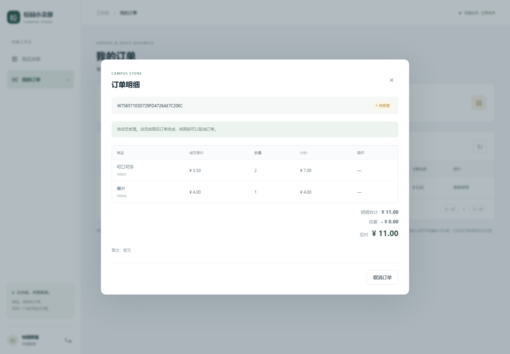
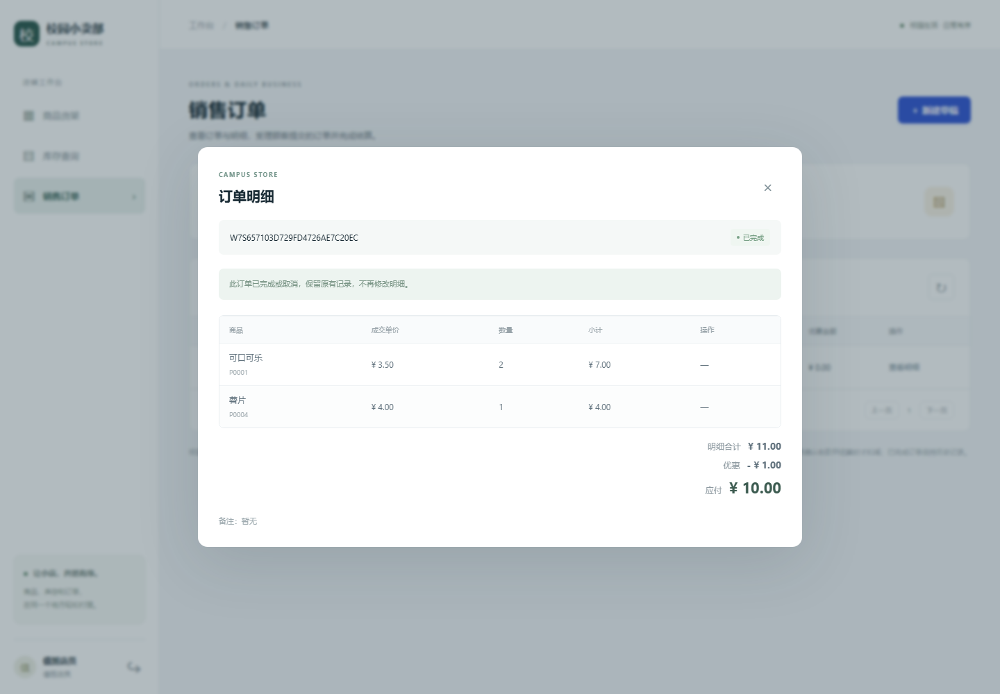
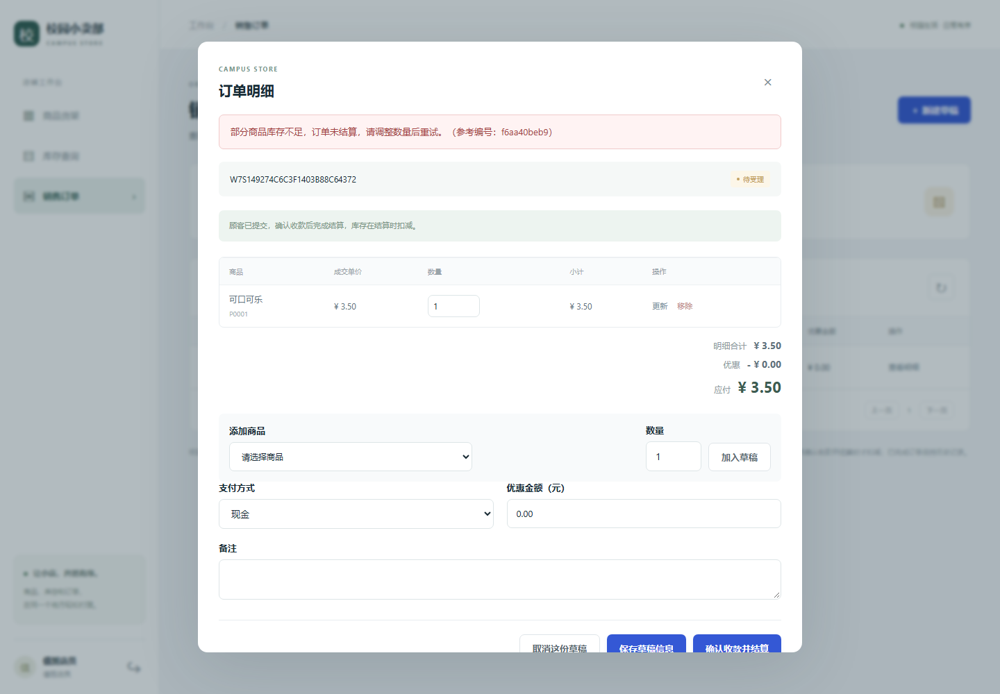
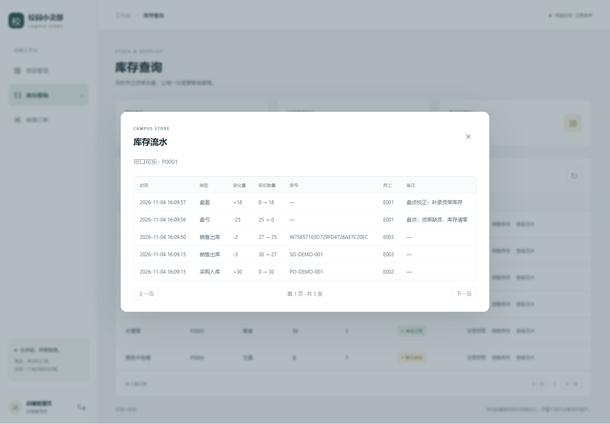
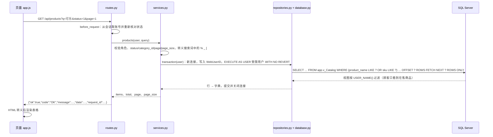
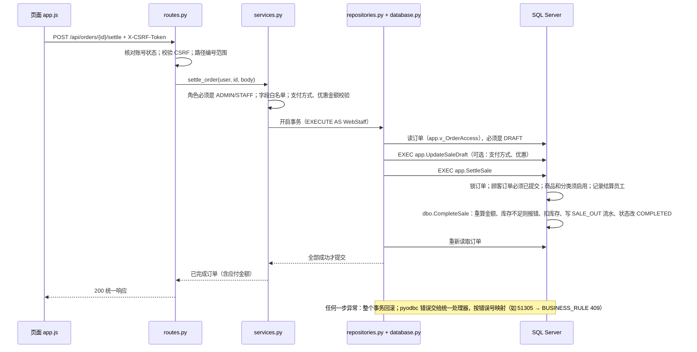
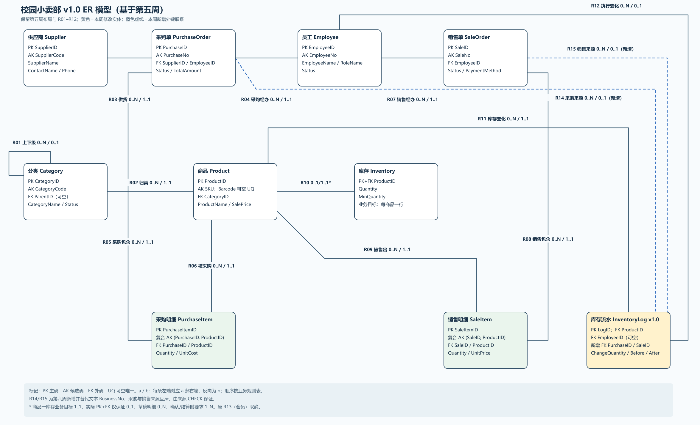
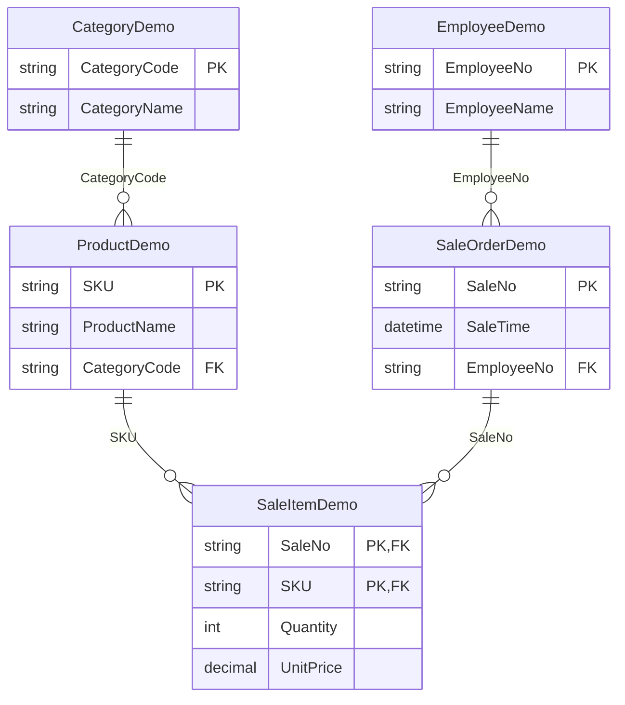

# 校园小卖部进销存系统

数据库课程项目：用 **SQL Server（T-SQL）** 建立校园小卖部进销存数据库，在第二阶段（第 5—9 周）完成规范化迁移，并在其上实现 **Flask + pyodbc** Web 应用。
最初的[要求文档](要求.md)以 MySQL 为例，本项目按已选定的 SQL Server 实现，不能在 MySQL 客户端中运行。

> 本文所有命令都在**仓库根目录**运行（交付包 `v1.0-final` 中，仓库根目录对应 `code/` 目录，请先 `cd code`）。命令使用 Windows PowerShell 写法。

## 目录

1. [项目简介与最终功能](#1-项目简介与最终功能)
2. [运行环境](#2-运行环境)
3. [项目结构图](#3-项目结构图)
4. [从空环境复现](#4-从空环境复现)
5. [操作手册](#5-操作手册)
6. [一次查询和一次修改经过哪些层](#6-一次查询和一次修改经过哪些层)
7. [ER 图、依赖分析、范式与分解方案](#7-er-图依赖分析范式与分解方案)
8. [迁移与回归](#8-迁移与回归)
9. [测试与结果](#9-测试与结果)
10. [已知限制](#10-已知限制)

## 1. 项目简介与最终功能

数据库有 10 张核心业务表（分类、供应商、员工、商品、库存、采购单及明细、销售单及明细、库存流水），以及业务视图、存储过程、触发器和数据库角色。完整业务链是：建商品 → 采购确认入库 → 顾客下单 → 店员结算 → 库存和流水自动更新。

最终的 Web 应用有三个角色：

| 角色 | 能做什么 |
| --- | --- |
| 顾客 | 浏览在售商品（可按名称、编号和分类查询），加入购物车，修改并提交订单，查看自己的订单（待受理、已完成、已取消），取消订单 |
| 店员 | 查看商品、库存和全店订单，受理顾客已提交的订单并结算，自己开单并结算 |
| 管理员 | 店员的全部操作，另外维护商品（新增、编辑、停用、安全删除）、设置库存预警、盘点调整库存（必填原因）、查看库存流水 |

订单流转：**购物车 → 待受理（顾客已提交）→ 已完成 / 已取消**。库存只在结算（已完成）时扣减，并同时写库存流水。应用层包含登录与会话、CSRF 保护、参数化查询、统一错误响应和 JSON 审计日志，业务 SQL 在不含 db_owner 的受限数据库身份下执行。

第二阶段完成的内容：

- 第 5 周：为 10 张表建立 ER 模型，梳理联系基数（见[第 7 节](#7-er-图依赖分析范式与分解方案)）。
- 第 6 周：函数依赖与范式分析，受控反规范化取舍，把库存流水的文本 `BusinessNo` 迁移为订单外键，并做迁移回归（见[第 8 节](#8-迁移与回归)）。
- 第 7 周：Flask 四层应用、登录、商品增改查、库存查询、订单草稿。
- 第 8—9 周：顾客提交与店员结算、库存盘点调整与流水、环境预检与旧库升级工具、界面和身份加固、最终回归与交付整理。

第 1—4 周（第一阶段）的基础交付保持原样，简述如下：

| 周次 | 内容 | 位置 |
| --- | --- | --- |
| 1 业务边界 | 小卖部场景、角色职责、采购与销售流程、暂不纳入的数据 | [docs/week1-business.md](docs/week1-business.md) |
| 2 关系与码 | 10 张表的字段、类型、主码、候选码、外码 | [docs/week2-schema.md](docs/week2-schema.md)、[建库脚本](submissions/v0.1-week4/sql/01_create_campus_store_database.sql) |
| 3 DDL 与 CRUD | 从空库建表、样例数据、可重复的商品增删改查 | [sql/crud.sql](sql/crud.sql)、[sql/03_sample_data.sql](sql/03_sample_data.sql) |
| 4 连接、视图、完整性、授权 | 多表查询、统计视图、主外键与 CHECK、数据库角色与越权测试 | [sql/query.sql](sql/query.sql)、[sql/view.sql](sql/view.sql)、[sql/constraint.sql](sql/constraint.sql)、[sql/role.sql](sql/role.sql)、[sql/negative_cases.sql](sql/negative_cases.sql) |

第 1—4 周的冻结版本在 `submissions/v0.1-week4/`，第 6、7 周提交包在 `submissions/v1.0-week6/`、`submissions/v1.0-week7/`，都不再修改。`Employee.RoleName` 是员工的经营职责，与 SQL Server 数据库角色、应用账号角色是三个不同的概念。

## 2. 运行环境

**实际验证环境**（2026-11-04，来自 [results/doctor.txt](results/doctor.txt) 和 [requirements-lock.txt](requirements-lock.txt)）：

| 项目 | 版本 |
| --- | --- |
| 操作系统 | Windows x64 |
| 数据库 | SQL Server 2025 Developer，默认实例（`MSSQLSERVER`），产品版本 17.0.1000.7，服务器名写 `"."` |
| Python | 3.13.12 |
| ODBC 驱动 | ODBC Driver 18 for SQL Server |
| 主要依赖 | Flask 3.1.3、pyodbc 5.3.0、waitress 3.0.2、Werkzeug 3.1.9；开发/验收另有 pytest 9.1.1、playwright 1.64.0（共 19 个锁定包） |
| 命令行工具 | sqlcmd 17.0.1000.7（`-No` 参数可用） |

**SQL Server Express 也适用**，只是服务器名不同：Express 通常是命名实例 `.\SQLEXPRESS`，所有工具的 `--server` 参数改成它即可（工具默认值就是 `.\SQLEXPRESS`）。第 7 周曾在 SQL Server Express + Python 3.14.2 上完成验证，详见[第七周验证记录](docs/week7-application/verification.md)；最终验证在上表环境上完成，没有在 Express 上重跑。

要求：Python 3.10 或更高；运行工具的 Windows 账号需能连接实例并创建数据库（`dbcreator` 或 `sysadmin`）。命令行与 SSMS 要连接同一个实例。

## 3. 项目结构图

```text
.
├── README.md                          本文件
├── requirements.txt / requirements-dev.txt / requirements-lock.txt / pytest.ini
├── app/                               Web 应用（四层结构）
│   ├── templates/index.html           ┐ 页面层：单页界面、表单、弹窗，用 fetch 调 JSON API
│   ├── static/app.js, app.css, store.svg ┘
│   ├── routes.py                      页面层后端入口：HTTP 路由、会话、CSRF，统一响应格式
│   ├── services.py                    业务层：角色、输入校验、订单状态、整次操作的事务边界
│   ├── errors.py                      业务层：数据库错误号 → 统一错误类别
│   ├── repositories.py                数据访问层：全部参数化 SQL，只调受限视图和过程
│   ├── database.py                    数据访问层：每请求一个连接、切换受限身份、提交/回滚
│   ├── config.py, __init__.py, __main__.py   配置、应用工厂与日志、启动入口
├── sql/                               数据库层
│   ├── 01_…07_*.sql, query.sql, view.sql, role.sql …   第 1—4 周建库、过程、视图、授权、反例
│   ├── week6/baseline.sql, migration.sql, regression.sql   第 6 周基线、迁移、回归
│   ├── week7/application.sql          app 架构：账号、订单归属、受限视图/过程、角色授权
│   └── week9/application_v2.sql, final_regression.sql      提交/结算/盘点过程；最终只读回归
├── tests/                             测试脚本
│   ├── week7/                         应用测试（pytest，真实 SQL Server）
│   └── Verify-*.ps1, Audit-Sql.ps1    第 1—6 周的隔离库验证脚本
├── tools/                             doctor、prepare_week7、upgrade_week9、verify_week7、浏览器验收、打包
├── docs/                              各周文档：week1/2、week5-er、week6-normalization、week7-application
├── report/                            阶段报告与小组分工
├── ai_log/                            AI 使用记录
├── results/                           实际运行结果、截图和说明（见 results/README.md）
└── submissions/                       各阶段冻结的提交包（v0.1-week4、v1.0-week6、v1.0-week7、v1.0-final）
```

四层与目录的对应关系：

| 层 | 职责 | 文件 |
| --- | --- | --- |
| 页面层 | 展示、表单、调用 API；路由层处理 HTTP、会话、CSRF 并把请求交给业务层 | `app/templates/`、`app/static/`、`app/routes.py` |
| 业务层 | 检查角色和输入，组织一次完整操作，划定事务边界，翻译错误 | `app/services.py`、`app/errors.py` |
| 数据访问层 | 唯一写 SQL 的 Python 文件，用 `?` 绑定参数；管理连接和事务 | `app/repositories.py`、`app/database.py` |
| 数据库层 | 表、视图、过程、触发器、约束、角色权限 | `sql/`，运行在 SQL Server |

约束：SQL 只能出现在 `repositories.py` 和 `sql/` 中，用户输入一律绑定参数；业务 SQL 用 `WebAdmin`/`WebStaff`/`WebCustomer` 三个受限用户执行。

## 4. 从空环境复现

“空环境”指没有 `.venv`、没有开发库。需要 SQL Server 正在运行、已安装 ODBC Driver 18、已安装真实的 Python 3.10+。下面用 `"."` 表示默认实例，Express 请改成 `".\SQLEXPRESS"`。

```powershell
# 1. 建虚拟环境（见下面的“python 命令不可用”）
python -m venv .venv

# 2. 安装依赖（精确版本）
.\.venv\Scripts\python.exe -m pip install -r requirements-lock.txt

# 3. 环境预检（只读，不建库）
.\.venv\Scripts\python.exe -m tools.doctor --server "."

# 4. 建开发库并生成 instance/settings.json
.\.venv\Scripts\python.exe -m tools.prepare_week7 --server "."

# 5. 启动，然后打开 http://127.0.0.1:5070，用 admin 登录
.\.venv\Scripts\python.exe -m app --port 5070
```

说明：

- **doctor 要在安装依赖之后运行**：它自己要导入 pyodbc，依赖没装时会直接报 `ModuleNotFoundError`。第一次在建库之前运行，“instance/settings.json”一项会失败（还没有配置文件）；如果这台机器上也没有默认开发库 `CampusStoreDB_W7_Development`，“开发库”一项同样失败，这些都是预期的。第 4 步之后再运行应全部通过（本机结果见 [results/doctor.txt](results/doctor.txt)：8 项全部通过）。
- **`python` 命令不可用时**：Windows 的应用执行别名会让 `python` 指向 `WindowsApps` 里的占位程序，它不是真正的 Python（doctor 的“Python 解释器”项会提示）。改用真实解释器的完整路径建虚拟环境，例如 `& "C:\Path\To\Python313\python.exe" -m venv .venv`、`py -3 -m venv .venv`，或 Miniconda 的 `& "$env:USERPROFILE\miniconda3\python.exe" -m venv .venv`；之后一律使用 `.\.venv\Scripts\python.exe`，不再依赖 `python`。
- **已有旧的开发库**：`prepare_week7` 不会覆盖已有库，会报“目标数据库已存在，拒绝覆盖”。如果该库还是第 7 周的版本，用升级工具补上第 9 周的增量（可重复执行，不删数据）：

  ```powershell
  .\.venv\Scripts\python.exe -m tools.upgrade_week9 --server "." --database CampusStoreDB_W7_Development
  ```

  如果 `instance/settings.json` 丢了而库还在，用环境变量指定：`CAMPUS_DB_SERVER`、`CAMPUS_DB_DATABASE`、`CAMPUS_SECRET_KEY`（至少 32 个字符）。想要另一个全新的库，加 `--database CampusStoreDB_W7_Team2`。
- **多个 ODBC 驱动**：工具默认选已安装的最高版本，可用 `--driver "ODBC Driver 18 for SQL Server"` 指定，结果写入 `instance/settings.json`。
- **命名说明**：`prepare_week7` 和 `CampusStoreDB_W7_` 前缀是历史命名——这个工具和数据库命名规则诞生在第 7 周，之后的第 8—9 周继续沿用，应用只接受名称匹配 `CampusStoreDB_W7_*` 的库。名字里的 7 不表示它只含第 7 周的内容，开发库已包含第 9 周的全部增量。
- `prepare_week7` 做的事：从冻结的 v0.1 建一个随机命名的 W6 副本 → 执行 `baseline.sql`、`migration.sql` → 改名为目标库 → 部署 `week7/application.sql` 与 `week9/application_v2.sql` → 写入演示账号。它不连接也不修改正式库 `CampusStoreDB`。
- 原始的第 1—4 周建库脚本只在空环境执行一次：`sqlcmd -S . -E -No -b -f 65001 -i sql\01_create_campus_store_database.sql`，之后依次是 `02_business_procedures.sql`、`view.sql`、`role.sql`、`03_sample_data.sql`（`-E` Windows 身份验证，`-No` 连接加密可选，`-b` 出错返回非零，`-f 65001` 以 UTF-8 读取）。如已有正式库，请改用隔离验证（第 9 节），不要为演示删除现有库。

## 5. 操作手册

打开 <http://127.0.0.1:5070>。**演示账号**（密码均为 `Campus2026!`，仅用于本地课程演示）：

| 用户名 | 角色 | 说明 |
| --- | --- | --- |
| `admin` | 管理员 | 关联员工 E001 |
| `staff` | 店员 | 关联员工 E003（收银） |
| `customer` | 顾客 | 无员工关联 |
| `customer2` | 另一位顾客 | 用来验证订单互相不可见 |

**权限矩阵**（完整版见[架构说明](docs/week7-application/architecture.md)）：

| 操作 | 管理员 | 店员 | 顾客 |
| --- | --- | --- | --- |
| 查看商品 | 全部 | 全部 | 仅在售 |
| 新增、编辑、停用、安全删除商品 | ✔ | ✘ | ✘ |
| 查看库存与预警 | ✔ | ✔ | ✘ |
| 设置预警下限 | ✔ | ✘ | ✘ |
| 盘点调整库存、查看库存流水 | ✔ | ✘ | ✘ |
| 直接修改 `Inventory.Quantity` | ✘ | ✘ | ✘ |
| 查看订单 | 全店 | 全店 | 仅本人 |
| 加入购物车、改明细、取消 | ✔ | ✔ | 仅本人订单 |
| 提交订单 | ✘ | ✘ | 仅本人 |
| 结算订单 | ✔ | ✔ | ✘ |
| 指定成交价、优惠 | ✔ | ✔ | ✘ |

### 顾客：加入购物车 → 提交 → 等待受理

登录后在商品货架点“加入购物车”（同一商品再次加入会累加数量），到“我的订单”调整数量、保存备注和支付方式，点“提交订单”。提交时若商品价格刚被调整，系统会刷新价格并提示再次确认；提交成功后价格按提交时确定，状态变为“待受理”，只能取消、不能再改。



### 店员：受理并结算

在“销售订单”选“待受理”，打开订单，核对支付方式、登记优惠，点“确认收款并结算”。同一事务内扣减库存、写库存流水、订单变为已完成；任何商品库存不足时整单回滚，订单仍是待受理。





### 管理员：商品、库存、盘点

管理员可维护商品；在“库存查询”点“调整库存”，填写新数量和调整原因，系统记一条盘盈或盘亏流水；点“查看流水”按时间倒序查看某商品全部流水（采购入库、销售出库、盘点）。



更多截图（登录、商品管理、手机布局、已取消订单不显示应付金额等）按角色对应关系列在 [results/README.md](results/README.md)，逐步操作见[操作手册](docs/week7-application/user-manual.md)。

## 6. 一次查询和一次修改经过哪些层

### 查询：商品列表



### 修改：店员结算订单



## 7. ER 图、依赖分析、范式与分解方案

本节从 [docs/week5-er](docs/week5-er/README.md) 和 [docs/week6-normalization](docs/week6-normalization/README.md) 提炼；完整推导见这两个目录以及 [results/normalization/](results/normalization)。

### 7.1 ER 图

下图是第 6 周的 v1.0 ER 图（基于第 5 周布局；黄色为第 6 周修改的实体，蓝色虚线为新增的外键联系）。可编辑的 draw.io 源文件和第 5 周 v0.1 图见 [results/er/](results/er)。



主要联系（`a / b`：给定左端一行可对应右端 a 行，反向对应 b 行）：

| 联系 | 基数 | 实现 |
| --- | --- | --- |
| 分类 → 子分类（R01） | 0..N / 0..1 | `ParentID` 可空外键，触发器拒绝环 |
| 分类 → 商品（R02） | 0..N / 1..1 | `Product.CategoryID` 非空外键 |
| 供应商、员工 → 采购单（R03、R04） | 0..N / 1..1 | 采购单必有供应商和经办员工 |
| 采购单/销售单 → 明细（R05、R08） | 0..N / 1..1 | 草稿可无明细，确认或结算时必须至少一行；同一商品一单一行（`UNIQUE(订单ID, ProductID)`） |
| 商品 → 采购明细/销售明细（R06、R09） | 0..N / 1..1 | 订单与商品是 M:N，由明细表拆成两个 1:N |
| 商品 → 库存（R10） | 业务目标 1..1，库内实际 0..1 | `Inventory.ProductID` 既是主码又是外键；触发器在新增商品时补零库存 |
| 商品 → 库存流水（R11） | 0..N / 1..1 | 外键 |
| 员工 → 库存流水（R12） | 0..N / 0..1 | 经办员工可空 |
| 采购单 → 库存流水（R14，第 6 周新增） | 0..N / 0..1 | `InventoryLog.PurchaseID` 可空外键 |
| 销售单 → 库存流水（R15，第 6 周新增） | 0..N / 0..1 | `InventoryLog.SaleID` 可空外键 |

第 5 周曾拟议“会员”实体（R13），第 6 周因“不保存顾客身份”的业务边界取消，没有增加空壳表。应用层另有 `app.AppUser`、`app.SaleOwner` 两张表（含 `SubmittedAt`），不改变核心十表，见[应用层数据字典](docs/week7-application/data-dictionary.md)。

### 7.2 依赖分析

函数依赖 `X → Y` 来自业务规则和约束，不是从样例数据猜出来的。

| 关系 | 候选码 | 主要函数依赖 |
| --- | --- | --- |
| Category / Supplier / Employee | 代理码、业务编号（如 CategoryCode） | 两个候选码分别决定全部属性 |
| Product | ProductID；SKU | 两个候选码决定全部属性；`Barcode` 可空，只在非空子集内唯一，不是码 |
| Inventory | ProductID | ProductID → Quantity, MinQuantity, UpdatedAt |
| PurchaseOrder / SaleOrder | ID；单号 | 候选码决定全部属性；SaleOrder 另有 (TotalAmount, DiscountAmount) → PayableAmount |
| PurchaseItem / SaleItem | 明细 ID；(订单 ID, ProductID) | 复合候选码决定全部属性；(Quantity, UnitCost/UnitPrice) → LineAmount |
| InventoryLog | LogID | LogID → 全部属性；(BeforeQuantity, ChangeQuantity) → AfterQuantity |

注意 `ProductID → SaleItem.UnitPrice` **不是**有效依赖：同一商品在不同订单可以不同价成交，商品当前售价不决定历史成交价。`Inventory.Quantity` 与订单总额还有“跨关系维护规则”：库存是已生效流水的当前快照，订单总额等于明细之和，它们靠事务维护，不是单表内的函数依赖。

### 7.3 更新异常

用一张教学宽表 `SaleFactWide(SaleNo, SaleTime, EmployeeNo, EmployeeName, SKU, ProductName, CategoryCode, CategoryName, Quantity, UnitPrice)`（一单一商品一行，码为 `(SaleNo, SKU)`）说明为什么要拆表。其中 SaleNo → SaleTime, EmployeeNo；SKU → ProductName, CategoryCode；EmployeeNo → EmployeeName；CategoryCode → CategoryName，这些依赖的决定因素都不是码，只满足 1NF。

| 异常 | 宽表中的表现 | 拆表后 |
| --- | --- | --- |
| 插入异常 | 没有任何销售记录的新商品、新员工、新分类无处可存 | 商品、员工、分类各有自己的表，可单独录入（新增商品由触发器补零库存） |
| 修改异常 | 分类改名要改每一条用过它的销售行，漏改就不一致 | 分类名只存在 `Category` 一行，商品用外键引用 |
| 删除异常 | 删掉某商品唯一的销售行，商品资料也随之丢失 | 删明细不影响商品；有交易引用的商品不能删，只能停用 |

现有 10 张表已经是独立实体，上述异常在实体之间不会出现；仍然存在的冗余是库存数量、订单总额、行金额和流水前后值，它们靠事务、触发器、计算列和 CHECK 约束维护（见 7.4）。

### 7.4 范式判断

1NF：字段原子。2NF：明细表虽有复合候选码 `(订单 ID, ProductID)`，数量和成交价不部分依赖其真子集，满足。3NF 要求每个非平凡依赖 `X → A` 的 X 是超码或 A 是主属性。

| 表 | 去掉派生字段后的基础属性关系 | 含计算列/审计字段的完整物理关系 | 处理 |
| --- | --- | --- | --- |
| Category、Supplier、Employee、Product、Inventory、PurchaseOrder | 3NF | 3NF | 保留；订单总额、库存快照作为受控的跨关系冗余 |
| PurchaseItem | 3NF（去掉 LineAmount） | **不满足**：(Quantity, UnitCost) → LineAmount，决定因素不是超码 | 保留持久化计算列，数据库计算，不能人为写入 |
| SaleOrder | 3NF（去掉 PayableAmount） | **不满足**：(TotalAmount, DiscountAmount) → PayableAmount | 保留计算列 |
| SaleItem | 3NF（去掉 LineAmount） | **不满足**：(Quantity, UnitPrice) → LineAmount | 保留成交价和计算列 |
| InventoryLog | 3NF（去掉 AfterQuantity） | **不满足**：(BeforeQuantity, ChangeQuantity) → AfterQuantity | 保留前后值作为审计，CHECK 约束校验 |

结论：基础业务属性关系在所列依赖下达到 3NF；**完整物理关系不能说十表全部达到 3NF**——计算列和审计前后值是有意保留的“受控反规范化”，换来查询简单、审计可追溯、不必每次扫描全部明细或流水，代价由事务、锁、触发器和 CHECK 来保证一致。

### 7.5 分解方案

宽表 `SaleFactWide` 按依赖逐步分解为 5 个关系，每个依赖都落在某个子关系内：



依次提取员工、分类、商品、订单头时，每一步分解的公共属性（EmployeeNo、CategoryCode、SKU、SaleNo）都决定被提取关系的全部属性，满足二元无损连接条件，逐次无损则整体无损；各依赖在对应子关系内直接保持，明细表的组合码依赖也保留。这是设计层面的证明，有限样例连接成功不能替代它。

**实际的迁移改造**不是继续拆表，而是修正一处真实缺陷：v0.1 的 `InventoryLog.BusinessNo` 是普通文本，数据库不能保证它指向真实订单。第 6 周把它替换为 `PurchaseID`、`SaleID` 两个可空外键，并用检查约束 `CK_InventoryLog_Source` 保证来源类型互斥且与 `ChangeType` 匹配，`CK_InventoryLog_Direction` 保证入库为正、出库为负；视图 `v_inventory_log_detail` 用 LEFT JOIN 把业务单号还原出来，完整流水仅管理员可读。

| ChangeType | PurchaseID | SaleID | ChangeQuantity |
| --- | --- | --- | --- |
| PURCHASE_IN / PURCHASE_RETURN | 必填 | 必须空 | 入库正、退货出库负 |
| SALE_OUT / SALE_RETURN | 必须空 | 必填 | 出库负、退货入库正 |
| STOCKTAKE_IN / STOCKTAKE_OUT | 必须空 | 必须空 | 入库正、出库负 |

### 7.6 为什么不机械拆表

对已经是独立实体的 10 张表继续拆分，只会增加连接和事务复杂度而得不到更少的异常；有计算列的表要拆，就得把“数量×单价”之类的结果搬到别处，反而要靠应用代码去同步。因此取舍是：不拆表，证明现有划分合理，保留有维护措施的冗余，只修复确实缺少约束的来源引用。

## 8. 迁移与回归

迁移脚本在 `sql/week6/`：`baseline.sql`（迁移前采集基线）→ `migration.sql`（迁移）→ `regression.sql`（回归）。它们**只能在名称为 `CampusStoreDB_W6_*` 的 v0.1 数据库副本上运行**，会拒绝正式库和其他名称；迁移只能执行一次，重复迁移会被拒绝（错误 51610）。

**方式一：自动隔离验证（推荐）**。脚本从冻结的 v0.1 建一个随机命名的临时库，完成基线、迁移、回归和专项验证，结束后只删除自己创建的库：

```powershell
powershell -NoProfile -ExecutionPolicy Bypass -File tests\Verify-Week6Migration.ps1 -ServerInstance "."
```

`-NoProfile -ExecutionPolicy Bypass -File` 的写法不受本机脚本执行策略影响，Windows PowerShell 5.1 即可运行（`.ps1` 文件带 UTF-8 BOM）。

**方式二：手工在副本上运行**。先在 SSMS 把 v0.1 的备份还原成新副本（如 `CampusStoreDB_W6_Group1`；副本已有结构和数据，不要再运行固定库名的 01 建库和 03 样例脚本），然后：

```powershell
sqlcmd -S . -E -No -b -f 65001 -d CampusStoreDB_W6_Group1 -i sql\week6\baseline.sql
sqlcmd -S . -E -No -b -f 65001 -d CampusStoreDB_W6_Group1 -i sql\week6\migration.sql
sqlcmd -S . -E -No -b -f 65001 -d CampusStoreDB_W6_Group1 -i sql\week6\regression.sql
```

迁移后不能重跑 v0.1 的 `02_business_procedures.sql`，否则会恢复已删除 `BusinessNo` 的写法。

**关键的前后结果**（2026-11-04 本机实际运行，完整输出见 [results/migration/](results/migration)）：

| 项目 | 迁移前（baseline） | 迁移后 |
| --- | --- | --- |
| 10 张业务表行数 | 分类 5、供应商 2、员工 3、商品 6、库存 6、采购单 3、采购明细 6、销售单 3、销售明细 5、流水 11 | 与基线差异 0 |
| 已收货采购总额 | 222.00 | 222.00 |
| 已完成销售原价总额 | 44.50 | 44.50 |
| 库存流水来源 | 文本 `BusinessNo`，无外键 | `PurchaseID`/`SaleID` 外键 + 来源、方向 CHECK |
| 业务单号显示 | 直接存储 | `v_inventory_log_detail` 还原，11 行与迁移前一致 |
| 越权与非法数据 | — | 非采购/销售角色读完整流水得错误 229；收银员直接改库存得错误 229；非法外键、来源冲突、方向错误均被拒绝 |
| 回归结果 | — | `regression.sql` 21 项全部通过；订单状态保护 8 项通过；迁移边界 3 项和异常路径清理 1 项通过 |

另有一份只读的最终回归 `sql/week9/final_regression.sql`，在最终 W7 库上核对库存与流水、订单金额、销量统计、外键与流水来源、受限角色权限，每项输出预期值和实际值（第 9 节）。

## 9. 测试与结果

所有测试都在真实 SQL Server 上运行，不用 SQLite 替代，每次使用随机命名的测试库并在结束时清理。

| 命令 | 内容 | 本次结果（2026-11-04） |
| --- | --- | --- |
| `.\.venv\Scripts\python.exe -m tools.doctor --server "."` | 环境预检 | 8 项全部通过（[doctor.txt](results/doctor.txt)） |
| `powershell -NoProfile -ExecutionPolicy Bypass -File tests\Verify-Week6Migration.ps1 -ServerInstance "."` | 第 6 周迁移 | 退出码 0，21 + 8 + 3 + 1 项通过（[输出](results/migration/verify-week6-migration.txt)） |
| `powershell -NoProfile -ExecutionPolicy Bypass -File tests\Verify-CampusStore.ps1 -ServerInstance "."` | 第 1—4 周主流程与反例 | 退出码 0（[输出](results/migration/verify-campusstore.txt)） |
| `sqlcmd -S . -E -No -b -f 65001 -d CampusStoreDB_W7_Development -i sql\week9\final_regression.sql` | 最终只读回归 | 30 项通过、0 项失败（[final-regression.txt](results/final-regression.txt)） |
| `.\.venv\Scripts\python.exe -m tools.verify_week7 --server "."` | 应用集成测试 + 浏览器验收 | **307 项集成测试通过、26 项浏览器验收通过**、0 个未捕获 JavaScript 异常（[app-test/](results/app-test)） |
| `.\.venv\Scripts\python.exe -m tools.package_final`、`-m tools.smoke_package --server "."` | 生成交付包；把 zip 解压到临时目录，按包内 README 空环境复现 | 全部步骤通过，admin 登录 200，测试库和临时目录已清理（[package-smoke.json](results/package-smoke.json)） |

单独运行集成测试：

```powershell
$env:CAMPUS_TEST_SERVER = "."
.\.venv\Scripts\python.exe -m pytest -v
```

浏览器验收需先 `.\.venv\Scripts\python.exe -m playwright install chromium`（或用 `--browser-executable` 指定已有浏览器）；只测后端可加 `--skip-browser`。上面两个 `.ps1` 命令都用 `powershell -NoProfile -ExecutionPolicy Bypass -File …` 的写法，不受脚本执行策略影响。

**安全性结论**（证据与测试名见 [results/README.md](results/README.md)）：

- **参数化查询**：用户输入全部以 `?` 绑定，搜索词中的 `%`、`_`、`[` 按字面转义；引号注入登录、注入型 SKU 都被拒绝，不改变查询结果。
- **身份与权限**：每个请求一个新连接，用 `EXECUTE AS USER … WITH NO REVERT` 切到固定受限用户，业务代码执行 `REVERT` 回不到 dbo（4 个身份均测试）；四个 Web 身份都不是 db_owner，不能直接改 `Inventory.Quantity`，三个业务身份读取 `app.AppUser` 被拒绝（错误 229），已由最终回归在开发库上复核。顾客订单在数据库视图中再次按归属过滤，他人订单统一 404。
- **会话与 CSRF**：签名 Cookie 只存账号 ID 和令牌，每次请求重新核对账号和员工状态，停用立即生效；写操作必须带当前 CSRF 令牌；登录失败不区分账号是否存在。
- **统一异常**：所有失败都返回 `ok/code/message/data/request_id`，覆盖输入错误、未登录、无权限、数据不存在、业务规则、连接失败、约束冲突、事务失败等类别（表格见 results/README.md），前端不出现 SQL、堆栈、路径或连接信息，详细错误只写后端日志并用请求编号关联。
- **并发与事务**：同一用户并发加购只会得到一张购物车（`sp_getapplock`），同一订单重复结算只扣一次库存，结算与盘点并发时流水前后值保持连续，库存不足时整单回滚。

## 10. 已知限制

- **数据库连接身份**：应用连接本身仍使用运行者的 Windows 身份，再切换到受限用户（`EXECUTE AS USER … WITH NO REVERT`），没有配置独立的低权限 SQL 登录。切换到受限用户后业务代码无法回到 dbo，但这不等于已部署了最小权限的服务账号；正式部署需要专用的低权限连接身份。
- **范围**：没有真实支付（支付方式只是订单上的一个字段）、没有采购界面（采购入库只有数据库过程 `dbo.ConfirmPurchase`，没有页面）、没有退货（`SALE_RETURN`、`PURCHASE_RETURN` 流水类型只是预留）、没有登录限流（可以无限次尝试密码）。
- **价格**：顾客提交订单后，价格按提交时确定，之后商品调价不再影响这张订单；提交前价格变化时需要顾客重新确认一次。库存在提交时只提示不预留，库存可能在提交与结算之间被别的订单用掉，结算时会被拒绝。
- **演示账号**：`admin`、`staff`、`customer`、`customer2` 和统一密码 `Campus2026!` 只用于本地课程演示，不能用于正式环境。服务只监听 `127.0.0.1`，没有 HTTPS，`SESSION_COOKIE_SECURE` 默认关闭。
- **脚本与环境**：`tools.doctor` 要在安装依赖之后才能运行。最终验证只在 SQL Server 2025 Developer 默认实例 + Python 3.13.12 上完成，Express 与 Python 3.14 是第 7 周的验证结果，没有在最终版重跑。
- **最终回归的数据范围**：`final_regression.sql` 在开发库上运行，该库只有 v0.1 的演示数据（3 张已完成订单、11 条流水）；应用测试产生的订单在已清理的随机测试库里，没有在开发库上积累。

## 文档索引

- 各周文档：[第五周 ER](docs/week5-er/README.md)、[第六周规范化与迁移](docs/week6-normalization/README.md)、[第七至九周应用](docs/week7-application/README.md)（[操作手册](docs/week7-application/user-manual.md)、[架构](docs/week7-application/architecture.md)、[API](docs/week7-application/api.md)、[数据字典](docs/week7-application/data-dictionary.md)、[验证记录](docs/week7-application/verification.md)）
- 阶段报告：[report/阶段报告.md](report/阶段报告.md)；小组分工：[report/小组分工.md](report/小组分工.md)
- AI 使用记录：[ai_log/](ai_log)
- 实际结果：[results/README.md](results/README.md)
