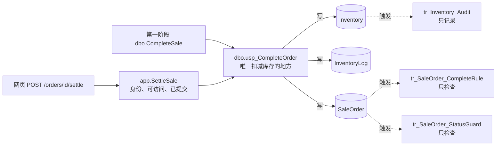

# 第三阶段第 10—12 周：存储过程、函数、触发器、窗口与递归查询、业务事务

本目录说明第 10—12 周新增的数据库对象、递归逻辑、事务边界和对象调用关系。所有对象都部署在 v1.0 应用库（`CampusStoreDB_W7_*`）上，脚本可重复执行：

| 周 | 脚本 | 内容 |
| --- | --- | --- |
| 10 | [sql/week10/function.sql](../../sql/week10/function.sql) | 补货量函数、销售汇总表值函数、会员判断、折扣率与折扣金额函数 |
| 10 | [sql/week10/procedure.sql](../../sql/week10/procedure.sql) | 销售统计过程、库存调整过程、补货选择过程；订单表增加 `DiscountRate` |
| 10 | [sql/week10/test_week10.sql](../../sql/week10/test_week10.sql) | 调用与测试脚本（正常输入、空值、错误编号、错误日期、非法数量、非法折扣、重复调用） |
| 11 | [sql/week11/trigger.sql](../../sql/week11/trigger.sql) | 库存审计表与审计触发器、订单完成规则触发器 |
| 11 | [sql/week11/window_query.sql](../../sql/week11/window_query.sql) | 排名、累计值、移动平均三条窗口查询 |
| 11 | [sql/week11/test_week11.sql](../../sql/week11/test_week11.sql) | 单条插入、单条修改、多条修改、正常操作、非法数据、触发器拒绝；窗口结果核对 |
| 12 | [sql/week12/recursive_query.sql](../../sql/week12/recursive_query.sql) | 分类层级递归查询，含样例层级和根/中间/叶子/不存在编号四类查询 |
| 12 | [sql/week12/order_transaction.sql](../../sql/week12/order_transaction.sql) | 订单完成事务 `dbo.usp_CompleteOrder` |
| 12 | [sql/week12/restock_transaction.sql](../../sql/week12/restock_transaction.sql) | 模拟补货入库事务 `dbo.usp_ReceiveRestock` |
| 12 | [sql/week12/integration.sql](../../sql/week12/integration.sql) | 整合：网页改为调用以上过程和函数 |
| 12 | [sql/week12/test_week12.sql](../../sql/week12/test_week12.sql) | “初始数据—操作—预期结果—实际结果”验证记录 |

部署顺序由 `tools/prepare_week7.py` 的 `INCREMENT_SCRIPTS` 决定（新建库时自动执行；已有开发库用 `python -m tools.upgrade_week9 --server "." --database CampusStoreDB_W7_Development` 升级）。

运行全部验证并保存结果：

```powershell
.\.venv\Scripts\python.exe -m tools.verify_week12 --server "."
```

它新建随机测试库，依次运行三个测试脚本、窗口查询和递归查询，把每个脚本的消息与结果表保存到 [results/week10-12/](../../results/week10-12)，汇总写入 `summary.json`，然后删除测试库（加 `--keep` 保留，便于在 SSMS 中查看）。`pytest` 中的 `tests/week7/test_week10_12.py` 也会运行同一套脚本并要求全部通过。2026-11-25 实测：第 10 周 44/44、第 11 周 23/23、递归 5/5、第 12 周事务 18/18，随机库已清理。

## 1. 第 10 周：过程与函数

**过程与函数的分工**：会改变数据、需要事务和报错的业务写成过程（`EXEC` 调用，失败用 `THROW` 返回错误号）；只做计算或查询的写成函数（可以写在 `SELECT`、`WHERE`、`JOIN` 中，不能修改数据也不能 `THROW`，非法输入返回 `NULL`，由调用它的过程判断）。

| 对象 | 参数 | 返回 | 拒绝与错误 |
| --- | --- | --- | --- |
| `dbo.usp_SalesStatistics` 销售统计 | `@StartDate date, @EndDate date`（都包含当天） | 结果集 1：订单数、销售数量、原价、折扣、实收；结果集 2：各商品销售情况（来自 `fn_SalesSummary`） | 51701 日期为空；51702 开始晚于结束；51703 超过十年。没有销售时汇总为 0、明细为空 |
| `dbo.usp_AdjustInventory` 库存调整 | `@ProductCode`（SKU）、`@ChangeQuantity`（正为盘盈、负为盘亏）、`@Reason`、`@EmployeeNo`、`@Quiet` | 调整前后数量 | 51710 商品不存在；51711 数量为空、为零或超范围；51712 调整后为负（库存不足）；51713 员工不存在/停用/无库存职责；51714 原因为空。成功时同一事务更新库存并写盘盈/盘亏流水 |
| `dbo.usp_CreateRestockOrder` 补货选择 | `@SupplierID`、`@EmployeeNo`、`@PurchaseID OUTPUT`、`@Quiet` | 生成的补货单及明细 | 51720 供应商无效；51713 员工无采购职责；51721 没有需要补货的商品（不生成空单） |
| `dbo.fn_RestockQuantity` 补货量 | `@ProductID`、`@TargetQuantity`（`DEFAULT` 表示预警下限的 2 倍） | `int`：补到目标所差数量；已达目标返回 0，不会为负 | 商品不存在或目标为负返回 `NULL` |
| `dbo.fn_SalesSummary` 销售汇总（内联表值函数） | `@StartDate, @EndDate` | 商品编号、名称、销售数量、销售金额（折前）、订单数 | 日期为空或开始晚于结束返回空结果 |
| `dbo.fn_IsMemberOrder` | `@SaleID` | 网上顾客账号下的订单为 1（会员），店员开的散客单为 0 | 订单不存在返回 `NULL` |
| `dbo.fn_DiscountRate` / `dbo.fn_DiscountAmount` 折扣 | `@IsMember, @OrderAmount` | 折扣率（会员减 5%，满 100 元再减 5%）/ 折扣金额（四舍五入到分） | 参数为空或金额为负返回 `NULL` |

**折扣的保存**：`dbo.SaleOrder` 新增 `DiscountRate decimal(5,4)`。结算时由 `usp_CompleteOrder` 调用函数计算并把实际折扣率、折扣金额写入订单头，成交价一直保存在 `SaleItem.UnitPrice`，之后改商品售价不影响历史订单（`test_week10.sql` D-09）。第 10 周之前的订单是人工优惠，`DiscountRate` 为 `NULL`。已完成订单的折扣金额和折扣率都不能再改（D-10）。

**整合**：网页原来让店员手填“优惠金额”，现在取消；草稿订单显示按函数预估的折扣，结算时最终确定。经营统计页改为调用 `usp_SalesStatistics`、`fn_SalesSummary`（经 `app.fn_ProductSalesRank`）。采购页增加“按库存生成补货单”，调用 `usp_CreateRestockOrder`。

## 2. 第 11 周：触发器与窗口函数

**库存审计触发器 `dbo.tr_Inventory_Audit`**（`AFTER INSERT, UPDATE, DELETE`）：用 `inserted FULL OUTER JOIN deleted` 一次处理多行，每件商品写一条 `dbo.InventoryAudit`：商品、调整前后数量、变化量、调整前后预警下限、操作类型（INSERT / INCREASE / DECREASE / MODIFY / DELETE）、操作时间、操作员工（业务过程写入的会话标记 `CampusStoreOperator`，没有时取网页账号对应的员工）、数据库用户和登录名。只改 `UpdatedAt` 的更新不记录。审计表不加外键，商品删除后审计仍保留。

**订单完成规则触发器 `dbo.tr_SaleOrder_CompleteRule`**（`AFTER UPDATE`，设为第一个触发）：只检查本次由“非已完成”变为“已完成”的行，集合方式处理多行。拒绝条件：没有明细（51750）、含停用商品或非法数量（51752）、库存没有按明细扣减——每个商品的销售出库流水合计必须正好等于购买数量（51753）、订单金额不等于明细合计（51754）、折扣金额非法或与折扣率不符（51755）；已完成订单再次设为已完成（51751）；已结束订单改折扣率（51756）。它和原有的 `tr_SaleOrder_StatusGuard`（只允许经过结算过程完成）配合：前者检查业务条件，后者检查是谁在改。

**窗口查询**（`window_query.sql`，结果见 results/week10-12/window_query.txt）：

| 查询 | 窗口 | 业务含义 |
| --- | --- | --- |
| 商品销售额排名 | `RANK / DENSE_RANK / ROW_NUMBER OVER (ORDER BY 销售额 DESC)` | 找出畅销品优先补货和陈列；三种排名在并列时的差别 |
| 按日期累计实收与累计销量 | `SUM(...) OVER (ORDER BY 销售日期 ROWS BETWEEN UNBOUNDED PRECEDING AND CURRENT ROW)` | 截至每天的营业额进度 |
| 最近 3 天移动平均实收 | `AVG(...) OVER (ORDER BY 日期 ROWS BETWEEN 2 PRECEDING AND CURRENT ROW)`，先生成连续日期，没有销售的日子按 0 | 平滑单日波动，为第四阶段补货预测提供参考 |

网页经营统计页的“每日销售”显示累计实收和近 3 天平均（`app.fn_DailySalesTrend`），“商品销量”显示排名（`app.fn_ProductSalesRank`）。

## 3. 第 12 周：递归查询

层级沿用 `dbo.Category.ParentID`。`dbo.usp_CategoryDescendants @CategoryID` 用递归 CTE 查出指定分类及全部后代：

- **起点**：指定分类，层级 0，路径为自身名称；
- **递归连接**：`JOIN dbo.Category child ON child.ParentID = 上一层.CategoryID`，层级 +1，路径接上子分类名称；
- **终止**：没有更深的子分类时自然结束；`tr_Category_PreventCycle` 已阻止成环，另用编号路径判重并设 `MAXRECURSION 32` 作保险；
- 路径列在起点和递归部分都转换为 `nvarchar(1000)`。

脚本在事务中临时补上孙节点“碳酸饮料”（食品→饮料→碳酸饮料）和另一条分支（文具→书写工具→中性笔），查询根节点、中间节点、叶子节点、另一分支和不存在的编号，核对行数、层级、父级和路径后回滚。网页按分类筛选商品时使用的 `app.v_CategoryScope` 也是同样的递归逻辑（父分类包含子分类）。

## 4. 第 12 周：业务事务

### 涉及的表

`SaleOrder 1—N SaleItem N—1 Product 1—1 Inventory 1—N InventoryLog / InventoryAudit`；补货单沿用采购单结构：`PurchaseOrder`（补货单头，DRAFT=待入库、RECEIVED=已入库、`ReceivedTime`=入库时间）`1—N PurchaseItem`（补货单编号—商品—数量）。补货单可以人工填写，也可以由 `usp_CreateRestockOrder` 按库存预警生成；第四阶段只需把明细数量换成预测结果。

### 统一库存扣减入口

原 Web 程序不是下单即扣库存：顾客提交只锁定订单，店员结算时才扣减。本周把结算整合进订单完成事务：



补货入库同理：网页 `app.ConfirmPurchase` 和第一阶段的 `dbo.ConfirmPurchase` 都只调用 `dbo.usp_ReceiveRestock`。

### 事务边界

`usp_CompleteOrder` 的步骤：锁订单头（`UPDLOCK, HOLDLOCK`）→ 检查状态（不存在 51730、已完成 51731、已取消 51732）、经办员工、支付方式 → 按商品汇总需求量（无明细 51302、数量非正 51733、停用商品 51304）→ 用函数计算折扣 → **带库存条件扣减**：`UPDATE … WHERE Quantity >= 需求量`，用 `OUTPUT` 收集实际改动的行，行数少于商品数即库存不足（51305）→ 写销售出库流水 → 改订单为已完成（触发器再核对）→ 提交。`usp_ReceiveRestock` 结构相同：锁补货单 → 检查（不存在 51740、已入库 51741、已取消 51742、无明细 51201、数量非正 51743、停用商品 51744、员工 51203、供应商 51204）→ 加库存 → 写采购入库流水 → 改为已入库并写入库时间 → 提交。

- 直接调用（没有外层事务）：过程自己 `BEGIN TRAN … COMMIT`，失败 `ROLLBACK`；
- 在网页请求中调用：网页层每个请求一个事务，过程只建保存点；失败回滚到保存点并抛错，网页层随后回滚整个请求，**最终提交只有网页层一次**（`test_week12.sql` O-09 演示外层回滚后订单和库存都恢复）；
- 触发器不提交、不扣库存；审计表随业务事务一起回滚，不能当作失败日志；
- `@FailAfterStock=1` 仅供测试，在库存已改、流水已写之后、单据完成之前 `THROW`，证明前面的写入被撤销（O-03、R-03）；
- 重复调用同一单据被拒绝，库存不会重复扣减或增加（O-02、R-02）。

### 验证记录

`results/week10-12/test_week12.txt` 按“初始数据—操作—预期结果—实际结果”记录订单（O-01～O-09）和补货（R-01～R-08）的正常提交、中途失败回滚、重复调用和规则拒绝，每个用例同时核对库存、流水、审计、单据头和单据明细。每个用例开始前把测试商品 P、Q 的库存重置为 P=10、Q=5。

## 5. 错误号

第 10—12 周新增 51701—51756（见 `app/errors.py`），网页统一映射为输入错误（400）、数据不存在（404）或业务规则（409），提示中不出现 SQL 或对象名。51799 只在测试中由 `@FailAfterStock=1` 触发。

## 6. 分工与 AI 使用

分工由组员填写；AI 使用见 [ai_log/](../../ai_log)。
