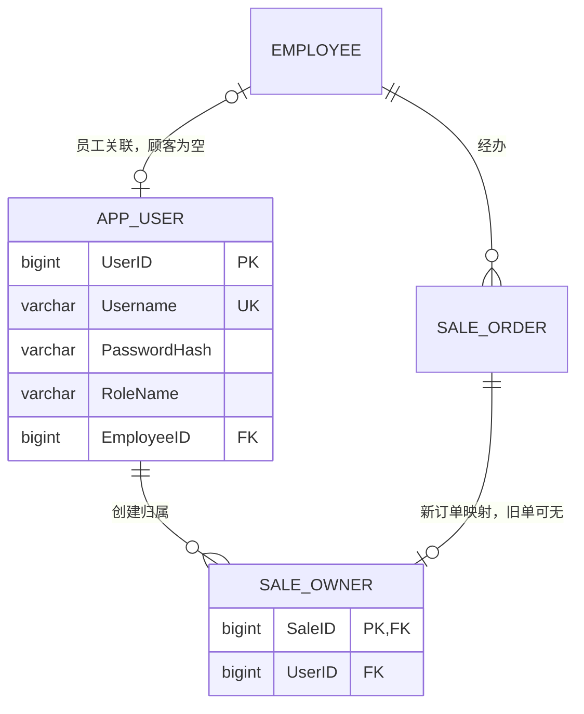

# 四层结构、事务与权限

页面只处理表单、fetch和结果展示。routes负责HTTP、会话和CSRF，services检查角色、输入、业务状态，
repositories集中SQL，database管理连接及事务。SQL Server执行FK、CHECK、唯一约束和原触发器。
搜索按商品名/SKU参数化查询，%/_/[作字面转义。修改后重新查询再提交，失败交给统一处理器并回滚。

草稿创建在同一连接/事务写SaleOrder、SaleOwner和全部SaleItem。最后一件商品无效、
重复或金额超范围时，订单头、归属和之前明细全部撤销。修改/取消过程锁定订单头，
再检查可见性和DRAFT状态。业务服务组织事务边界，DAO持有连接，过程不提前提交调用者事务。
商品删除先锁定并确认零库存且无明细/流水引用，在同一事务删除零库存行及商品。

## 新增关系

| 表与字段 | 键/限制 | 用途 |
| --- | --- | --- |
| app.AppUser.UserID | bigint identity PK | 应用身份，不等同EmployeeID |
| Username | varchar(40)，非空唯一 | 登录用户名 |
| PasswordHash | varchar(255)，非空 | 带随机盐的scrypt哈希 |
| DisplayName | nvarchar(50) | 页面名称 |
| RoleName | ADMIN / STAFF / CUSTOMER | 应用角色 |
| EmployeeID | 可空FK→Employee，非空时唯一 | 员工账号必填，顾客必须空 |
| Status、CreatedAt | 启用标志、时间 | 每请求核实启用状态 |
| app.SaleOwner.SaleID | PK且FK→SaleOrder | 一单至多一个归属 |
| UserID | FK→AppUser，索引(UserID,SaleID) | 后端记录创建账号，不接收前端指定 |
| CreatedAt | 默认时间 | 创建时间 |

旧订单不猜测归属。新顾客草稿默认由配置E003受理，写入前检查员工启用及CASHIER/ADMIN职责；
不新增会员积分、等级或真实支付功能。

新增关系与原有员工、销售单的映射如下。原第六周ER图仍保存数据库重构时的十张核心表，
本图补充第七周应用身份和归属，不覆盖旧图。

## 角色矩阵

| 操作 | 管理员 | 店员 | 顾客 |
| --- | --- | --- | --- |
| 商品与分类查询 | 全部商品 | 全部商品 | 仅启用商品/分类 |
| 商品增改、安全删除 | 允许 | 拒绝 | 拒绝 |
| 内部库存与预警查询 | 允许 | 允许 | 拒绝 |
| 调整库存预警阈值 | 允许 | 拒绝 | 拒绝 |
| 直接改实际库存Quantity | 拒绝 | 拒绝 | 拒绝 |
| 销售订单查询 | 全店 | 全店 | 仅本人 |
| 草稿/明细操作、取消 | 允许 | 允许 | 仅本人草稿 |
| 指定草稿单价/优惠 | 允许 | 允许 | 拒绝，价格由服务器确定 |
| 改删、取消完成订单 | 拒绝 | 拒绝 | 拒绝 |
| 业务身份读取密码哈希 | 拒绝 | 拒绝 | 拒绝 |

WebAuth仅供后端认证读取，没有业务写权限。原Campus*角色不变，新建四个独立受限应用角色。
不把原Viewer可读全店销售统计的权限授给顾客。
WebAdmin只获得商品INSERT/UPDATE、更新条件所需ProductID读取、库存MinQuantity更新和受控过程执行；
店员/顾客无业务表直接DML权限。视图/过程通过同一dbo所有者的所有权链访问底层对象。

订单视图对WebAdmin/WebStaff开放全店，其他身份按只读SESSION_CONTEXT(WebUserID)过滤；
明细视图再次连接受控订单视图。另一顾客订单统一404，即使直接查视图也不返回越权记录。
关闭连接池，每请求单独连接、结束撤销模拟并关闭，防止身份和会话键跨用户复用。

## 认证、异常与日志

签名Cookie只保存账号ID和CSRF令牌，不保存密码或客户端决定的角色。
每次API请求重新核对账号/员工状态与职责，停用立即生效；写操作必须提供当前CSRF令牌。
关闭只读请求刷新永久会话Cookie，避免退出时旧查询响应覆盖退出Cookie。
页面对用户文本作HTML转义，不显示SQL、连接串、堆栈或服务器路径。

响应统一为ok、code、message、data、request_id。
参数400，认证401，权限/CSRF403，缺失或不可见404，业务/重复/约束409，连接503，内部异常500。
JSON日志位于instance/logs/application.jsonl，保留SQL错误、堆栈和请求ID；
请求日志记录时间、操作、方法、用户ID、角色、错误码、状态及结果，
不记录密码、表单请求体或Cookie。前端参考编号可定位完整请求ID。

管理准备工具与业务连接分开。Windows身份用于建立本地连接，所有HTTP业务SQL在固定受限用户下执行；
这不是已部署独立低权限服务登录的证明。正式部署仍需专用连接身份、HTTPS和非演示凭据。
