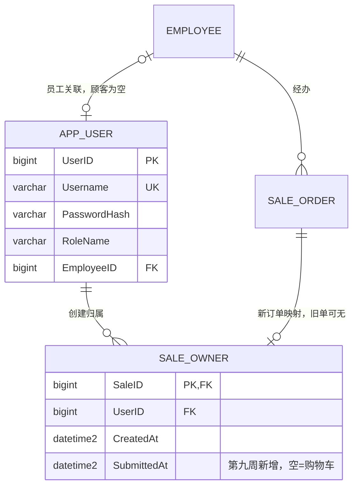
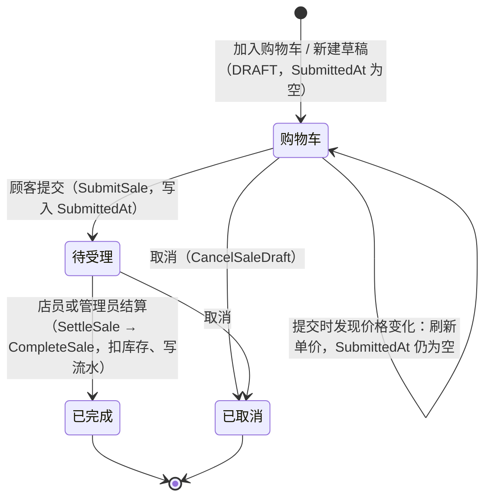

# 四层结构、事务与权限

页面只处理表单、fetch和结果展示。routes负责HTTP、会话和CSRF，services检查角色、输入、业务状态，
repositories集中SQL，database管理连接及事务。SQL Server执行FK、CHECK、唯一约束和原触发器。
搜索按商品名/SKU参数化查询，%/_/[作字面转义。修改后重新查询再提交，失败交给统一处理器并回滚。

草稿创建在同一连接/事务写SaleOrder、SaleOwner和全部SaleItem。最后一件商品无效、
重复或金额超范围时，订单头、归属和之前明细全部撤销。修改/取消过程锁定订单头，
再检查可见性和DRAFT状态。业务服务组织事务边界，DAO持有连接，过程不提前提交调用者事务。
商品删除先锁定并确认零库存且无明细/流水引用，在同一事务删除零库存行及商品。

## 新增关系

| 表与字段 | 键/限制 | 用途 |
| --- | --- | --- |
| app.AppUser.UserID | bigint identity PK | 应用身份，不等同EmployeeID |
| Username | varchar(40)，非空唯一 | 登录用户名 |
| PasswordHash | varchar(255)，非空 | 带随机盐的scrypt哈希 |
| DisplayName | nvarchar(50) | 页面名称 |
| RoleName | ADMIN / STAFF / CUSTOMER | 应用角色 |
| EmployeeID | 可空FK→Employee，非空时唯一 | 员工账号必填，顾客必须空 |
| Status、CreatedAt | 启用标志、时间 | 每请求核实启用状态 |
| app.SaleOwner.SaleID | PK且FK→SaleOrder | 一单至多一个归属 |
| UserID | FK→AppUser，索引(UserID,SaleID) | 后端记录创建账号，不接收前端指定 |
| CreatedAt | 默认时间 | 创建时间 |
| SubmittedAt | datetime2(0)，可空（第九周新增） | 顾客提交订单的时间；空表示仍在购物车，非空表示待店员受理。由SubmitSale写入，顾客不能直接设置 |

旧订单不猜测归属。新顾客草稿默认由配置E003受理，写入前检查员工启用及CASHIER/ADMIN职责；
不新增会员积分、等级或真实支付功能。

新增关系与原有员工、销售单的映射如下。原第六周ER图仍保存数据库重构时的十张核心表，
本图补充第七周应用身份和归属，不覆盖旧图。

`SubmittedAt` 放在 app.SaleOwner 而不是核心表 SaleOrder 中：核心十表的结构、状态值域和既有触发器都保持不变，
“已提交”只是应用层的归属信息，不是新的订单状态。

## 订单状态流转

数据库里的订单状态仍然只有 `DRAFT`、`COMPLETED`、`CANCELLED`；界面上的“购物车”和“待受理”由 `DRAFT` 加 `SubmittedAt` 是否为空区分。

- 购物车：`status=DRAFT` 且 `SubmittedAt IS NULL`。顾客和员工都可以修改明细；员工自己开的草稿也是这个状态，可以不经提交直接结算。
- 待受理：`status=DRAFT` 且 `SubmittedAt IS NOT NULL`。顾客不能再改明细、备注和支付方式（错误 51811），只能取消；店员或管理员才能结算。
- 已完成、已取消是终态，状态保护触发器拒绝再修改；顾客订单未提交就结算会被拒绝（错误 51812）。
- 价格：加入购物车时按商品现价写入明细；提交时若现价不同，只刷新单价并要求顾客确认，确认后的再次提交才写入 `SubmittedAt`，结算按该价格成交，之后调价不影响这张订单。
- 库存：提交只检查并提示库存不足，不预留库存；真正扣减在结算时由 `dbo.CompleteSale` 完成。

## 角色矩阵

| 操作 | 管理员 | 店员 | 顾客 |
| --- | --- | --- | --- |
| 商品与分类查询 | 全部商品 | 全部商品 | 仅启用商品/分类 |
| 商品增改、安全删除 | 允许 | 拒绝 | 拒绝 |
| 内部库存与预警查询 | 允许 | 允许 | 拒绝 |
| 调整库存预警阈值 | 允许 | 拒绝 | 拒绝 |
| 调整库存数量（盘点，必填原因，经 app.AdjustInventory） | 允许 | 拒绝 | 拒绝 |
| 查看库存流水（app.v_InventoryLog） | 允许 | 拒绝 | 拒绝 |
| 采购入库（供应商查询、采购单、确认入库、取消，sql/week8） | 允许 | 拒绝 | 拒绝 |
| 直接改实际库存Quantity | 拒绝 | 拒绝 | 拒绝 |
| 销售订单查询 | 全店 | 全店 | 仅本人 |
| 加入购物车 / 草稿与明细操作 / 取消 | 允许 | 允许 | 仅本人订单 |
| 提交订单（SubmitSale） | 拒绝 | 拒绝 | 仅本人未提交的订单 |
| 结算订单（SettleSale） | 允许 | 允许 | 拒绝 |
| 指定草稿单价/优惠 | 允许 | 允许 | 拒绝，价格由服务器确定 |
| 改删、取消完成订单 | 拒绝 | 拒绝 | 拒绝 |
| 业务身份读取密码哈希（app.AppUser） | 拒绝 | 拒绝 | 拒绝 |

WebAuth仅供后端认证读取，没有业务写权限。原Campus*角色不变，新建四个独立受限应用角色。
不把原Viewer可读全店销售统计的权限授给顾客。
WebAdmin只获得商品INSERT/UPDATE、更新条件所需ProductID读取、库存MinQuantity更新、app.v_InventoryLog查询和受控过程执行
（含AdjustInventory、SettleSale）；WebStaff可执行SettleSale；WebCustomer可执行SubmitSale；
三个业务身份对dbo.Inventory.Quantity都有DENY UPDATE，对app.AppUser都有DENY SELECT。
店员/顾客无业务表直接DML权限。视图/过程通过同一dbo所有者的所有权链访问底层对象。
这些权限由 `sql/week9/final_regression.sql` 在最终库上用 `HAS_PERMS_BY_NAME` 和一次真实读取重新核对。

订单视图对WebAdmin/WebStaff开放全店，其他身份按只读SESSION_CONTEXT(WebUserID)过滤；
明细视图再次连接受控订单视图。另一顾客订单统一404，即使直接查视图也不返回越权记录。
关闭连接池，每请求单独连接；用EXECUTE AS USER ... WITH NO REVERT切换到固定受限用户，
业务代码无法用REVERT回到管理身份，连接用完即关，防止身份和会话键跨用户复用。

## 认证、异常与日志

签名Cookie只保存账号ID和CSRF令牌，不保存密码或客户端决定的角色。
每次API请求重新核对账号/员工状态与职责，停用立即生效；写操作必须提供当前CSRF令牌。
关闭只读请求刷新永久会话Cookie，避免退出时旧查询响应覆盖退出Cookie。
页面对用户文本作HTML转义，不显示SQL、连接串、堆栈或服务器路径。

响应统一为ok、code、message、data、request_id。
参数400，认证401，权限/CSRF403，缺失或不可见404，业务/重复/约束/事务冲突409，连接503，内部异常500。
数据库错误只按驱动文本中紧跟 `(SQLxxx)`、`; [` 或结尾的错误号分类，用户数据里的数字（例如SKU `229`）不参与分类；
权限拒绝同时识别229和列级权限的230。并发冲突（死锁1205、锁等待超时、语句执行超时、SQLSTATE 40001）统一为
TRANSACTION_FAILED，只有连接阶段的超时和登录失败才是DATABASE_UNAVAILABLE。已知的业务过程错误号都有映射，不会落入500。
JSON日志位于instance/logs/application.jsonl，保留SQL错误、堆栈和请求ID；
请求日志记录时间、操作、方法、用户ID、角色、错误码、状态及结果，
不记录密码、表单请求体或Cookie。前端参考编号可定位完整请求ID。

管理准备工具与业务连接分开。Windows身份用于建立本地连接，所有HTTP业务SQL在固定受限用户下执行；
这不是已部署独立低权限服务登录的证明。正式部署仍需专用连接身份、HTTPS和非演示凭据。

## 事务边界

每个API请求在 `Database.transaction` 内使用一个独立连接、一个事务：关闭自动提交，设置会话选项和 `WebUserID`，
切换到受限用户，业务代码执行，全部成功才提交，任何异常整体回滚并关闭连接。事务由业务层（services）划定，
DAO只持有连接，过程不提前提交。

| 操作 | 同一事务内完成的内容 | 并发控制 | 失败结果 |
| --- | --- | --- | --- |
| 创建订单 | SaleOrder、SaleOwner、全部SaleItem | 锁定收银员工行 | 整单回滚，不留订单头 |
| 加入购物车 | 查找或新建当前草稿，新增或累加明细 | `sp_getapplock`（按 `cart:用户ID`，事务级排他，等待10秒）串行同一用户的并发加购 | 超时返回TRANSACTION_FAILED；商品无效时不留空草稿 |
| 提交订单 | 校验归属和未提交、空单、停用商品/分类、库存提示；价格变化时刷新单价；写SubmittedAt | 订单头 `UPDLOCK,HOLDLOCK` | 校验失败回滚，SubmittedAt不变 |
| 结算订单 | 可选地先更新支付方式和优惠，再执行SettleSale→CompleteSale：核对商品/分类启用、重算金额、扣库存、写流水、改终态 | 订单头、明细、库存行锁定；同一订单重复结算只扣一次 | 库存不足等任一步失败，连同刚改的支付方式和优惠全部回滚 |
| 调整库存 | 修改库存、写STOCKTAKE流水 | 库存行 `UPDLOCK,HOLDLOCK`；仅在过程内临时设置库存写入标记 | 失败回滚，标记在CATCH中清除 |
| 取消订单 | 订单状态改为CANCELLED | 订单头锁定 | 非草稿拒绝 |

结算与盘点并发时，两者都先锁库存行，因此流水的前后数量保持连续（`test_adjust_and_settle_race_keeps_log_chain`）。
