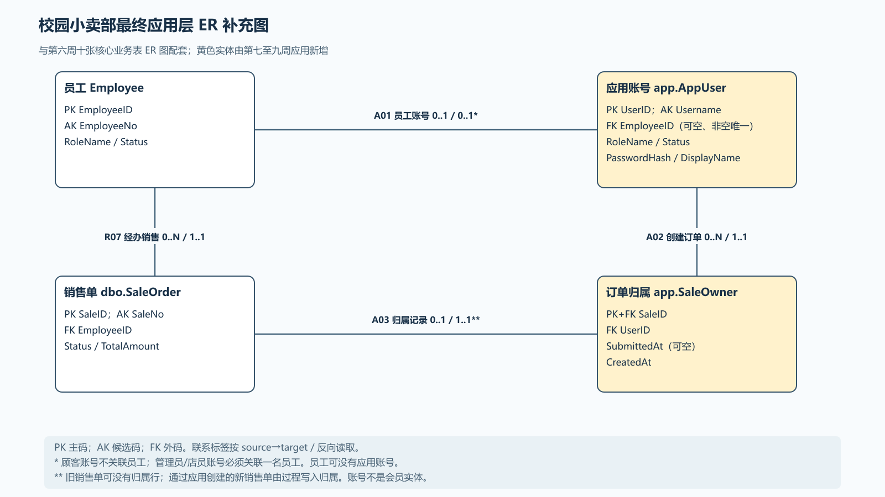

# 最终应用层 ER 补充图

第 5、6 周的 [核心业务 ER 图](../week6-normalization/week6-er.png)覆盖十张 `dbo` 业务表。第 7—9 周另外建立了登录账号与订单归属两张 `app` 表，因此用本图补齐最终数据库的持久实体关系。图中的 `Employee` 和 `SaleOrder` 是原有业务表，黄色的 `AppUser`、`SaleOwner` 是应用新增表；账号不等于会员积分实体。

- [可编辑 draw.io 源文件](app-er.drawio)
- [SVG 矢量图](app-er.svg)
- [PNG 预览图](app-er.png)

图采用与核心图相同的 `a / b` 约定：一条来源端记录可关联 `a` 条目标端记录，反向为 `b`。`0` 表示可选参与，`1` 表示必须参与。

| 联系 | 来源 → 目标 | 基数 a / b | 数据库实现与适用条件 |
| --- | --- | --- | --- |
| R07 | `Employee` → `SaleOrder` | `0..N / 1..1` | `SaleOrder.EmployeeID NOT NULL` 外键；一张销售单必须有一名经办员工。 |
| A01 | `Employee` → `AppUser` | `0..1 / 0..1` | `AppUser.EmployeeID` 可空外键，非空值有唯一索引。`CK_AppUser_Role` 要求管理员/店员账号关联员工、顾客账号不关联员工；员工可没有网页账号。员工职责与账号角色是否匹配由应用登录校验。 |
| A02 | `AppUser` → `SaleOwner` | `0..N / 1..1` | `SaleOwner.UserID NOT NULL` 外键；一个账号可创建多张销售单，一条归属行只指向一个账号。 |
| A03 | `SaleOrder` → `SaleOwner` | `0..1 / 1..1` | `SaleOwner.SaleID` 同时是主码和外码；第七周之前的旧销售单可以没有归属行，应用创建的新单由 `app.CreateSaleDraft` 在同一事务写入归属。 |

`SaleOwner.SubmittedAt` 可空：第九周顾客提交后填写，空值可表示仍在购物车或员工草稿。它不是外码，也不改变 `SaleOrder.Status` 的 `DRAFT`、`COMPLETED`、`CANCELLED` 值域。表与列的完整定义见[应用层数据字典](data-dictionary.md)及 [`sql/week7/application.sql`](../../code/sql/week7/application.sql)、[`sql/week9/application_v2.sql`](../../code/sql/week9/application_v2.sql)。
