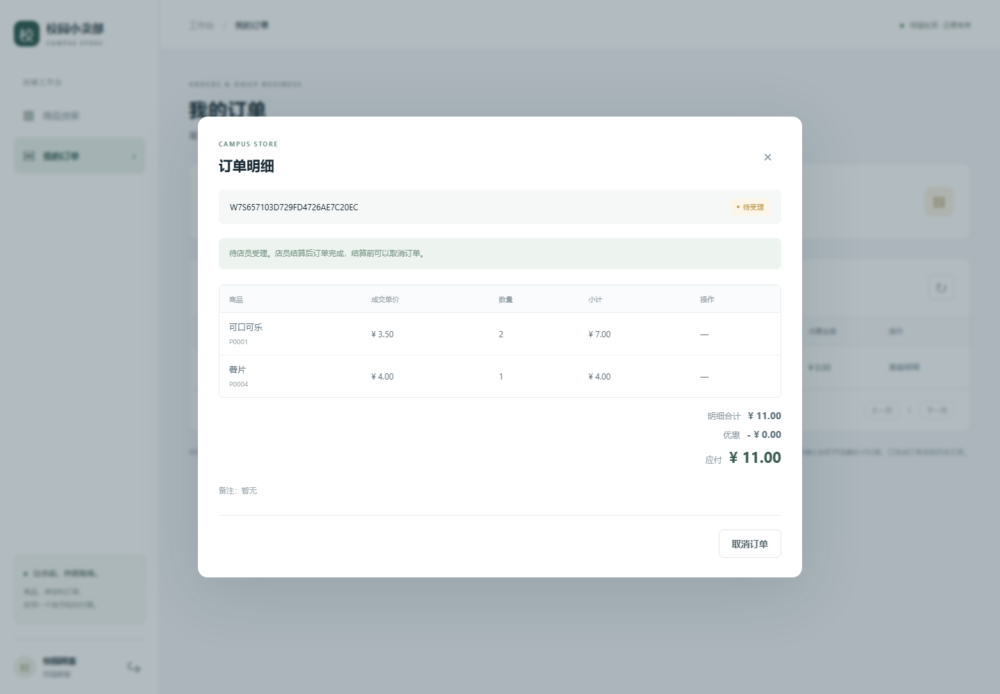
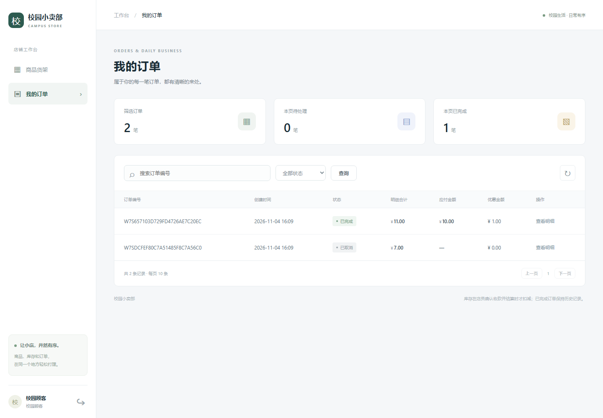
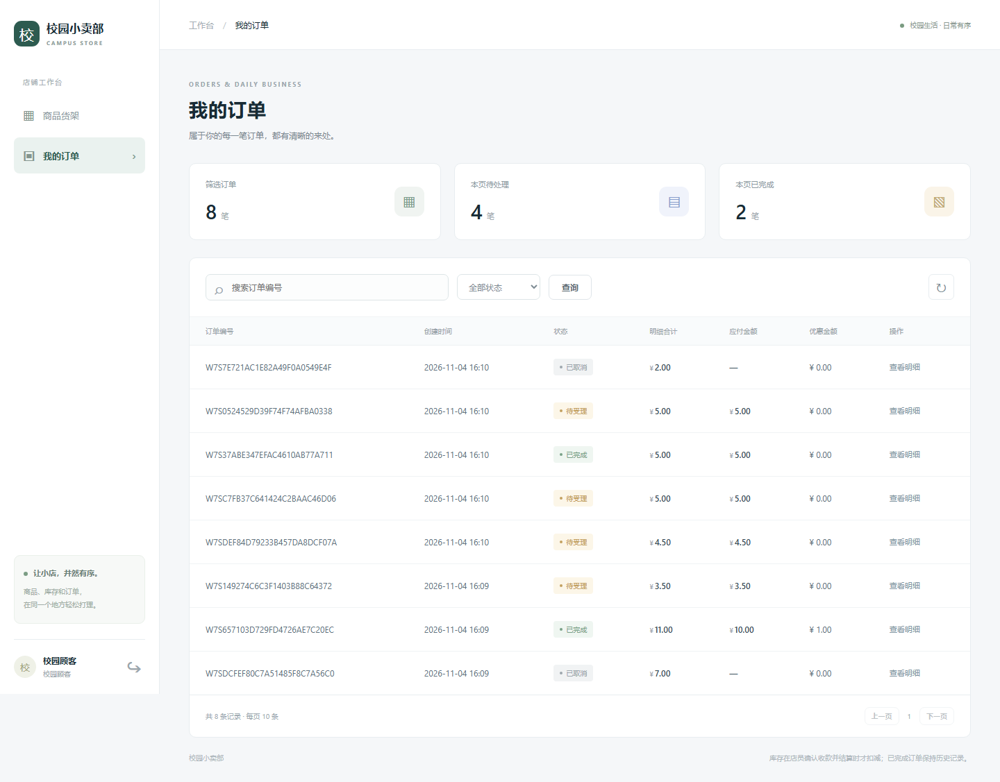
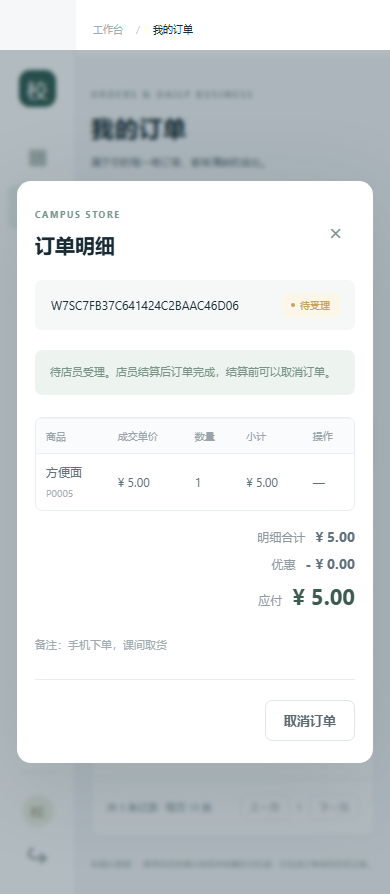
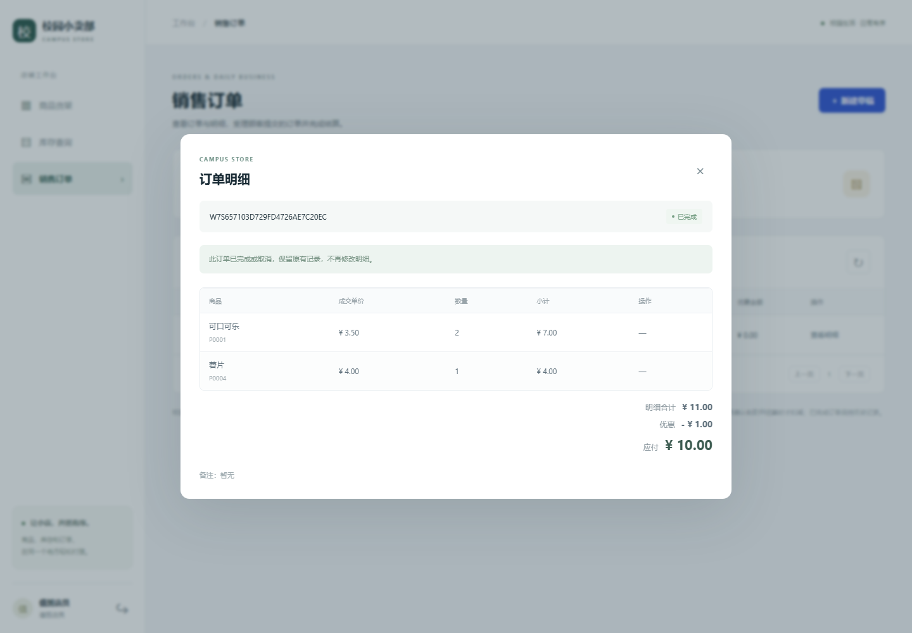
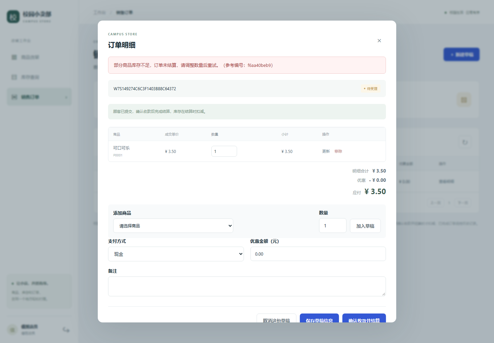
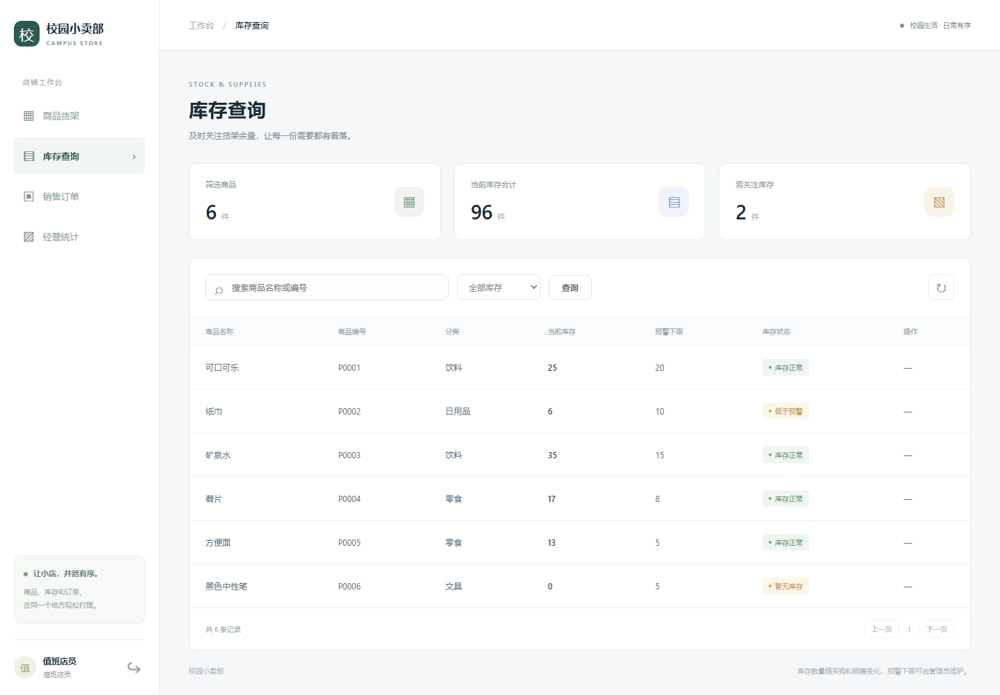
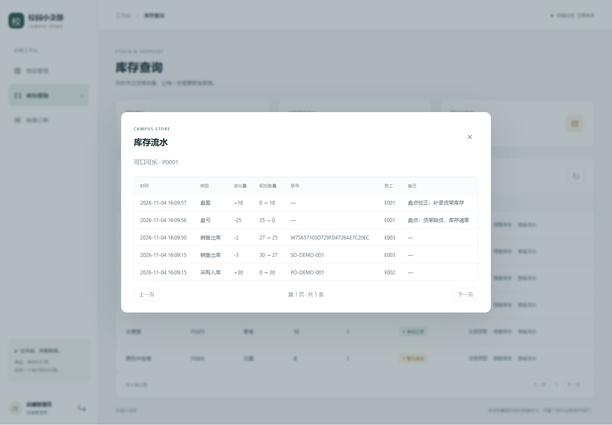
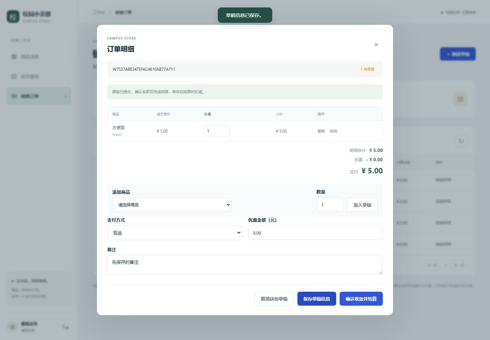

# 操作手册（第七至九周最终版）

启动方法和演示账号见[根目录 README](../../README.md)。打开 <http://127.0.0.1:5070>。演示账号密码均为 `Campus2026!`，只用于本地课程演示。
截图来自 `tools.verify_week7` 的真实浏览器运行，位于 [results/app-test](../../results/app-test)。

订单的生命周期：**购物车（顾客的草稿）→ 待受理（顾客已提交）→ 已完成 / 已取消**。库存只在“已完成”时扣减。

## 顾客（customer / customer2）

1. 登录后只看到“商品货架”和“我的订单”，没有内部库存和商品维护页；商品列表只显示在售商品。可以按商品名称或编号搜索，也可以用分类下拉框筛选后点“查询”；选“食品”这样的父分类时，会包含“饮料”“零食”等子分类的商品。
2. 在商品货架点“加入购物车”：系统取本人当前未提交的订单，没有就新建一张；同一商品再次加入时数量累加，仍是一张订单一行。
3. 打开“我的订单”，状态为“购物车”的订单可以修改数量、添加或移除商品、保存支付方式和备注。顾客不能指定成交价，也不能设置优惠。
4. 点“提交订单”。如果提交时商品现价与购物车中的单价不同，系统会刷新为现价并提示“部分商品价格已更新，请确认后重新提交”，核对后再点一次才算提交；提交成功后价格按提交时确定，不再随调价变化。
5. 提交后状态为“待受理”，明细、备注和支付方式不再能改，只剩“取消订单”。库存此时不预留。

   

6. 店员结算后状态变为“已完成”，详情显示明细合计、优惠和应付金额；被取消的订单不显示应付金额，显示“—”。

   

   

7. customer2 看不到 customer 的订单，直接请求接口也返回 404。
8. 手机宽度下表格在卡片内横向滚动，仍可提交订单和退出登录。

   

## 店员（staff）

1. 登录后可查商品货架、库存和销售订单；没有商品维护入口，库存页没有“调整库存”和“查看流水”按钮。
2. “销售订单”页的“待受理”筛选只列出顾客已提交、等待受理的订单；状态为“顾客选购中”的订单顾客还没有提交，不能结算。
3. 打开待受理订单，可确认支付方式、登记优惠（不得超过明细合计），点“确认收款并结算”。同一个事务内更新支付方式和优惠、扣减库存、写库存流水并把订单改为“已完成”。

   

4. 任一商品库存不足时整单结算失败，页面提示“库存不足”，订单仍是待受理，刚才改的支付方式和优惠也一并回滚。

   

5. 结算后在库存页能看到相应商品库存减少。

   

6. 店员也可以点“新建草稿”自己开单，用“加入草稿”选商品，保存后直接“确认收款并结算”，不需要顾客提交；店员可以为明细指定成交单价。

## 管理员（admin）

管理员具备店员的全部操作，另外可以：

1. **商品管理**：按名称或 SKU、状态查询；新增（SKU 唯一，初始库存为零）、编辑资料和售价、停用；刚新增且零库存、无业务引用的商品可删除，有历史记录的商品（如可口可乐）会被拒绝并提示应停用而不是删除。
2. **库存预警**：“设置预警”只改提醒下限，不改库存数量。
3. **调整库存（盘点）**：填写新数量和必填的调整原因，系统在同一事务内修改库存并写一条盘盈或盘亏流水（`STOCKTAKE_IN` / `STOCKTAKE_OUT`）。新数量与现有数量相同会被拒绝。
4. **查看流水**：按时间倒序分页显示某商品的全部库存流水，含采购入库、销售出库和盘点。

   

## 错误提示

- 输入格式、必填项和数值范围由页面和后端同时检查，错误只显示友好中文提示和参考编号，不显示 SQL、堆栈、路径或连接信息。
- 用户名或密码错误统一提示“用户名或密码不正确”，不区分账号是否存在。
- 重复 SKU/条码、订单中重复的商品、库存不足、订单状态已变化等业务冲突会明确拒绝，不留下半张订单。
- 账号被停用后，已登录的旧会话下一次请求即失效；页面过期（CSRF）时刷新后重试。
- 数据库暂时无法连接时只提示“系统暂时无法连接数据服务”；并发冲突或锁等待超时提示“操作因并发冲突未生效，请稍后重试”。
- 提示条显示在弹窗上方，弹窗内的错误会滚动到可视范围内。

  

左下角按钮退出登录。完整的错误响应分类和对应测试证据见 [results/README.md](../../results/README.md)。
