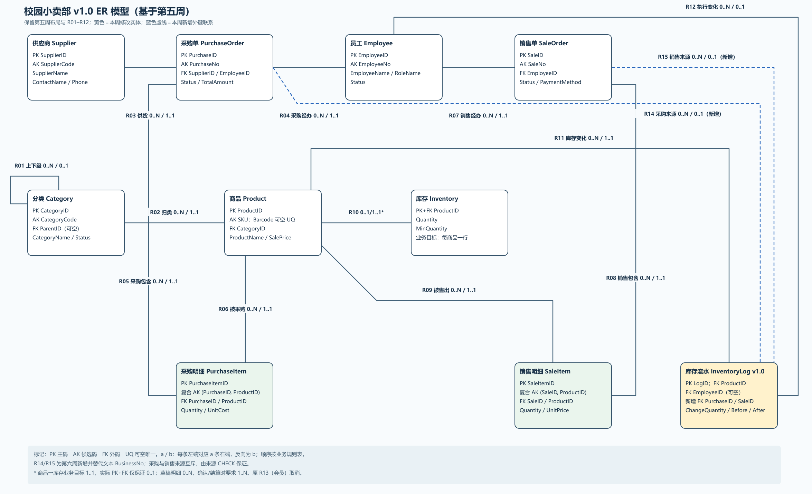
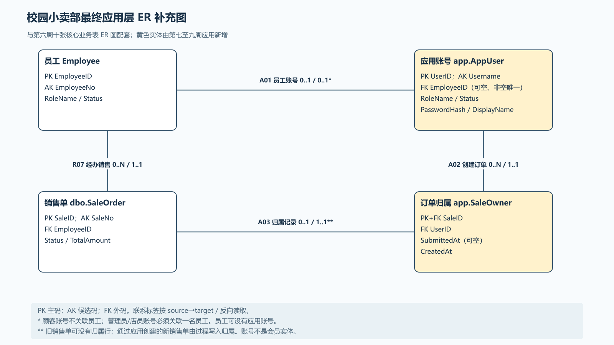
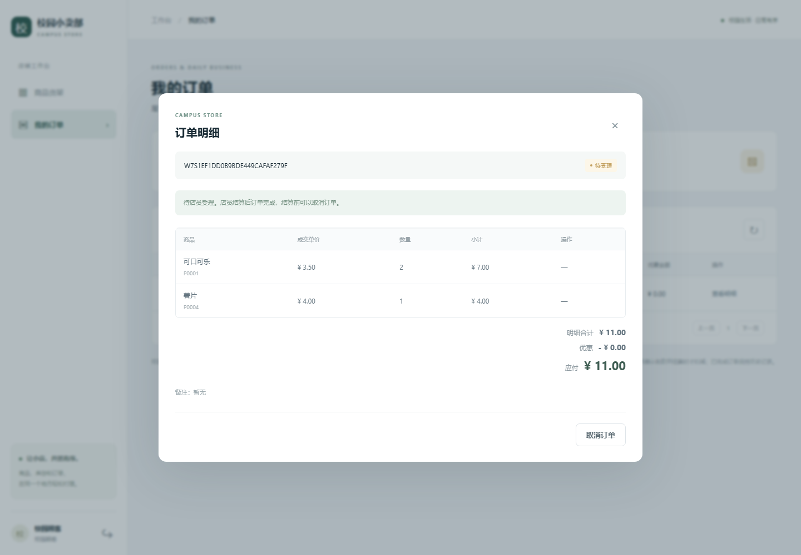
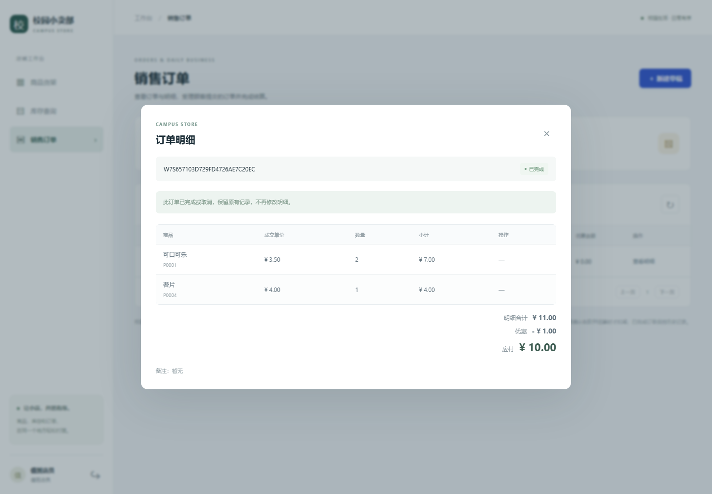
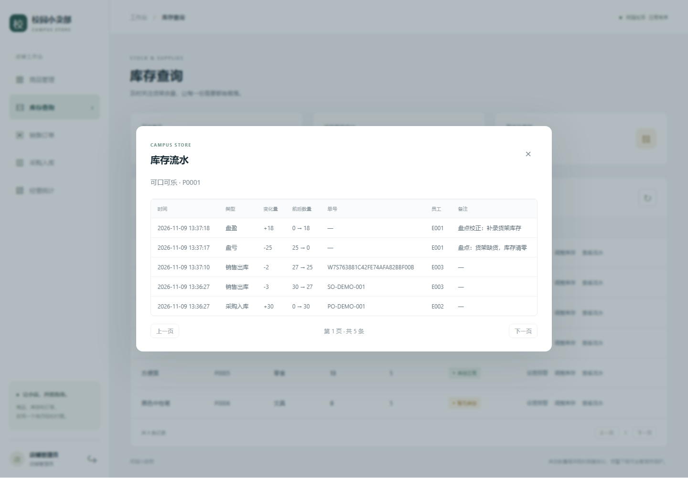

# 校园小卖部进销存系统：第二阶段（第 5—9 周）报告

> 应用、迁移、数据库测试与浏览器截图来自 2026-11-04 的本机实际运行；更新后的交付包于 2026-11-08 在 SQL Server Express 上重新做空环境烟测。来源见各节链接和 [results/README.md](../results/README.md)。没有依据的内容写“待组员补充”。个人姓名、学号和贡献见 [小组分工](小组分工.md)，AI 使用记录见 [ai_log/](../ai_log)。

## 1. 项目概述

项目用 SQL Server（T-SQL）实现校园小卖部进销存数据库，第二阶段做两件事：（1）对第一阶段的 10 张核心表做函数依赖与范式分析，并完成一次有回归验证的结构迁移；（2）在迁移后的数据库上实现 Flask + pyodbc 的 Web 应用，覆盖顾客下单、店员结算、管理员维护商品和盘点库存的完整流程。运行环境为 Windows、SQL Server 2025 Developer（默认实例）、Python 3.13.12、ODBC Driver 18。

## 2. 设计思路

### 2.1 ER 模型与联系基数（第 5 周）

十张表对应十个实体：分类、供应商、员工、商品、库存、采购单及明细、销售单及明细、库存流水。订单与商品是 M:N，由采购明细、销售明细两个关联实体拆成 1:N；明细表有单字段代理主码，并以 `(订单 ID, ProductID)` 为复合候选码（同一商品一单一行）。联系的左右基数、适用条件和实现方式逐条记录在 [docs/week5-er/business-rules.md](../docs/week5-er/business-rules.md)，图见 [results/er/](../results/er)。

第七至九周新增的网页账号 `app.AppUser` 和订单归属 `app.SaleOwner` 不在第六周冻结的十表图内；它们与 `Employee`、`SaleOrder` 的联系、键和参与条件见[最终应用层 ER 补充图](../docs/week7-application/app-er.md)。

### 2.2 依赖、范式与分解（第 6 周）

- 逐表写出候选码和函数依赖（[函数依赖清单](../results/normalization/functional-dependencies.md)）。基础业务属性关系在所列依赖下达到 3NF；完整物理关系中的 `LineAmount`、`PayableAmount` 和库存流水的 `AfterQuantity` 存在非码决定的派生依赖，严格判断不满足 3NF，因此**不能说十表全部达到 3NF**（[范式与异常分析](../results/normalization/normalization-analysis.md)）。
- 用教学宽表 `SaleFactWide` 展示插入、修改、删除三类异常，并把它逐步分解为员工、分类、商品、订单头、订单明细五个关系，用二元无损连接条件证明分解无损且依赖保持。
- 实际的结构改造只有一处：库存流水的文本 `BusinessNo` 换成 `PurchaseID`/`SaleID` 两个外键，加来源和方向两个检查约束（[目标结构](../results/normalization/target-schema.md)）。

### 2.3 设计取舍

**为什么不机械拆表。** 十张表已经是独立实体，插入、修改、删除异常在实体之间不会出现。若把“数量×单价”之类的派生值也拆走，就要靠应用代码去同步，反而更容易不一致。所以取舍是：先用函数依赖证明现有划分合理，再只修正确实缺少约束的地方（流水来源），而不是为了追求范式层数去拆表。

**为什么保留受控反规范化。** `Inventory.Quantity`、订单总额 `TotalAmount`、行金额 `LineAmount`、应付金额 `PayableAmount` 和流水的前后数量都是可由其他数据算出的冗余。保留它们换来库存查询不用扫描全部流水、统计不用每次汇总明细、流水可审计；代价由事务、`UPDLOCK,HOLDLOCK` 锁、触发器、计算列和 CHECK 约束承担，并用回归脚本持续核对（最终回归第 1—8 项）。这是“有理由的例外”，不是声称它们满足 3NF。

**为什么用 `SubmittedAt` 而不改核心表。** “顾客已提交、等待店员受理”是应用层概念。若在 `SaleOrder.Status` 里增加一个状态，就要修改核心表的约束、第 6 周的状态保护触发器和已验证的采购/销售过程，风险和回归成本都高。于是把时间戳放在应用层的 `app.SaleOwner.SubmittedAt`：`Status` 仍是 `DRAFT`/`COMPLETED`/`CANCELLED`，`DRAFT` 且 `SubmittedAt` 为空是购物车，非空是待受理。核心十张表、`sql/week6/` 脚本和 `week7/application.sql` 都没有改动，升级脚本 `week9/application_v2.sql` 可重复执行。

**为什么顾客下单和店员结算分开。** 顾客没有收款和扣库存的权限，也不应指定价格和优惠；店员在确认收款后才应改变库存。拆成“顾客提交”和“店员结算”两个动作，权限边界清晰（顾客只能执行 `SubmitSale`，店员/管理员才能执行 `SettleSale`），结算前库存不预留，可以防止顾客占库存不付款。提交时价格有变化就先要求顾客确认，结算按提交时确定的价格成交。

**为什么结算和盘点只保留一套。** 第 8 周的提交（7fba09b）实现了采购、销售结算和盘点；另一条开发线在第 7 周基础上实现了顾客提交、店员结算和库存调整，两条线的结算和盘点功能重复。合并时，采购和供应商来自第 8 周；结算和库存调整统一使用 `app.SettleSale`、`app.AdjustInventory`，因为前者区分顾客提交和店员结算，并记录实际结算的员工。第 8 周的 `app.CompleteSale`、`app.Stocktake` 及对应接口因此移除，重复功能的测试也一并移除，由第 9 周的测试覆盖。

### 2.4 应用架构与权限

页面层（`templates`、`static`、`routes.py`）→ 业务层（`services.py`、`errors.py`）→ 数据访问层（`repositories.py`、`database.py`）→ 数据库层（`sql/`）。SQL 只出现在数据访问层和 `sql/`，用户输入一律用 `?` 绑定。每个请求使用一个独立连接和一个事务，切换到 `WebAdmin`/`WebStaff`/`WebCustomer` 之一（`EXECUTE AS USER … WITH NO REVERT`），这三个用户和 `WebAuth` 都不是 db_owner，对 `Inventory.Quantity` 没有 `UPDATE` 权限，三个业务用户不能读 `app.AppUser`。订单可见性由视图 `app.v_OrderAccess` 按会话中的账号再次过滤。权限矩阵、状态流转图和事务边界见 [架构说明](../docs/week7-application/architecture.md)。

## 3. 实验过程

### 3.1 迁移与回归

迁移只在 v0.1 的数据库副本上进行，脚本自己拒绝正式库：`baseline.sql` 保存基线 → `migration.sql` 迁移 → `regression.sql` 回归。回归不只比较总数，而是逐单、逐行双向 `EXCEPT` 比较。2026-11-04 的实际运行（[完整输出](../results/migration/verify-week6-migration.txt)、[关键结果](../results/migration/key-results.md)）：

| 项目 | 迁移前 | 迁移后 |
| --- | --- | --- |
| 10 张业务表行数 | 5/2/3/6/6/3/6/3/5/11（分类、供应商、员工、商品、库存、采购单、采购明细、销售单、销售明细、流水） | 差异 0 |
| 已收货采购总额 / 已完成销售原价总额 | 222.00 / 44.50 | 222.00 / 44.50 |
| 流水来源 | 文本 `BusinessNo` | 订单外键 + 来源/方向 CHECK，11 行单号可还原 |
| 回归 | — | `regression.sql` 21 项通过；订单状态保护 8 项；迁移边界 3 项（重复迁移 51610、来源不匹配 51613、末尾失败整体回滚）；异常路径清理 1 项 |

越权也被验证：采购员、收银员、浏览者读取完整流水均得到错误 229，收银员直接改库存得到错误 229；非法外键、来源冲突、方向错误均被约束拒绝。第 1—4 周主流程脚本（[输出](../results/migration/verify-campusstore.txt)）同样退出码为 0。

### 3.2 应用的完整流程

| 阶段 | 内容 |
| --- | --- |
| 第 7 周 | 四层应用、三角色登录、商品增改查和安全删除、库存查询与预警、订单草稿；独立 W7 库与受限数据库身份 |
| 第 8—9 周 | 数据库层：`SubmitSale`、`SettleSale`、`AdjustInventory`、库存流水视图；接口：采购与供应商、购物车、提交、结算、盘点、待受理筛选、按分类查询商品；前端：采购入库、下单和结算界面、库存调整与流水；环境预检 `doctor`；旧库升级 `upgrade_week9` |
| 收尾 | 界面和身份加固、最终只读回归 `final_regression.sql`、结果整理与交付打包 |

三个角色的完整流程：顾客“加入购物车 → 提交订单 → 待受理”，店员“待受理 → 确认收款并结算 → 已完成”，管理员“商品维护、采购入库、盘点调整、查看流水”。每一步的截图见 [results/README.md](../results/README.md)，例如：

### 3.3 调试与修正

下列问题都是开发和测试中真实遇到并修复的，括号里是对应的提交和防回归测试（均在本次 324 项集成测试中通过）。

1. **数字 SKU 被当成权限错误。** 原来的错误号解析用正则取出错误文本里所有括号数字，SQL Server 的重复键消息会带上 `(229)`，于是 SKU 为 `229` 的重复商品被当成错误号 229（权限拒绝），返回 403。改为只解析驱动格式中紧跟 `(SQLxxx)`、`; [` 或文本结尾的括号数字（提交 06456ab；`test_numeric_duplicate_sku_is_duplicate_not_forbidden`、`test_duplicate_sku_229_is_not_a_permission_error`、`test_user_data_number_does_not_hide_51804`）。
2. **库存不足等过程错误返回 500。** 原映射没有包含 51305（库存不足）、51302、51303、51304、51301、51306、51011 等业务过程错误，它们落入“未知错误 500”。补充映射为 409 的 `BUSINESS_RULE` 并给出具体提示；同时新增 `TRANSACTION_FAILED` 类别，用于死锁（1205）、锁超时等并发失败（提交 06456ab；`test_business_rule_messages` 19 项、`test_transaction_failures_by_number`）。
3. **列级权限拒绝没有映射。** 对列的权限拒绝错误号是 230，原来只映射了 229，会返回 500。两者都映射为 `FORBIDDEN` 403（提交 3fec3c6；`test_column_permission_denied_230_is_forbidden_like_229`）。
4. **查询超时被当成连接失败。** 原来所有超时（HYT00/HYT01）都返回 503。现在按阶段区分：连接阶段超时才是 `DATABASE_UNAVAILABLE`（503），语句执行阶段的超时多半是锁等待，按 `TRANSACTION_FAILED`（409）处理，并把查询超时默认设为 15 秒（提交 3fec3c6；`test_blocked_inventory_update_times_out_as_transaction_conflict` 用真实锁阻塞复现，`test_connection_timeout_is_unavailable`、`test_query_timeout_is_transaction_conflict`）。
5. **分类停用后已提交订单仍能结算。** 顾客提交后，管理员停用商品所在分类，开发中的 `SettleSale` 初稿仍然可以结算该订单。现在 `SettleSale` 同时检查商品和分类的启用状态（该过程首次入库是提交 3fec3c6，入库时已含检查，所以 git 记录里看不到修复前的版本；`test_settle_rejects_disabled_category_after_submit`）。
6. **emoji 按 Python 长度计算会超出 `nvarchar` 上限。** 一个 emoji 在 Python 里长度是 1，在 SQL Server 的 `nvarchar` 中是 2 个 UTF-16 单位，128 个 emoji 的备注或原因会在数据库超限。改为按 UTF-16 代码单位校验，孤立代理项也按非法输入拒绝（提交 206e6d7；`test_overlong_reason_is_rejected_by_utf16_length` 4 项、`test_reason_of_255_utf16_units_is_saved_completely` 3 项）。
7. **同一用户并发加购会建出两张草稿。** 两个并发请求都看到“没有草稿”，各建一张。加入 `sp_getapplock`（按 `cart:用户ID` 的事务级排他锁），同一用户的加购串行执行（提交 206e6d7；`test_concurrent_cart_adds_keep_a_single_draft_and_the_full_quantity`）。交付前在临时副本里把加锁函数改成直接返回成功，该测试确实失败（1 failed），恢复后通过，说明这个测试能防住这个问题。
8. **业务连接执行 `REVERT` 能回到 dbo。** 原来的 `EXECUTE AS USER` 没有 `WITH NO REVERT`，业务代码执行 `REVERT` 就能回到管理身份。改为 `WITH NO REVERT`，并为 4 个受限身份各增加一个测试（提交 07eaadc；`test_business_code_cannot_revert_the_restricted_identity`）。
9. **界面问题**（浏览器验收中逐项检查）：
   - 顾客提交订单时，页面上尚未保存的备注丢失：提交前先保存备注和支付方式（修复于 10cca8e）。
   - 店员结算时同样会丢失未保存的备注：结算前先保存备注（修复于 07eaadc，验收项“改备注后直接结算”）。
   - 提示条被弹窗遮罩挡住：现在显示在弹窗之上（修复于 07eaadc，[截图 18](../results/app-test/18-toast-over-dialog.png)）。
   - 弹窗内的错误提示可能不在可视范围内：现在滚动到可视范围（修复于 07eaadc，[截图 19](../results/app-test/19-error-in-view-1366.png)）。
   - 已取消订单仍显示应付金额：现在显示“—”（修复于 07eaadc，[截图 20](../results/app-test/20-cancelled-no-payable.png)）。
10. **脚本编码：`.ps1` 没有 BOM。** 整理最终交付、运行 `tests\Verify-Week6Migration.ps1` 和 `tests\Verify-CampusStore.ps1` 时发现，这些脚本是不带 BOM 的 UTF-8，Windows PowerShell 5.1 按本地编码读取，遇到中文字符串报“字符串缺少终止符”，脚本一行都没有执行。交付前给 `tests\` 和 `tools\` 下全部 7 个 `.ps1` 加了 UTF-8 BOM（内容不变），用 `Parser::ParseFile` 在 5.1 下检查 0 个语法错误，之后直接运行仓库里的脚本重跑通过（退出码 0），不再用临时副本。处理过程见 [key-results.md](../results/migration/key-results.md)。

11. **合并两条开发线。** 本地分支长期没有同步远端，推送时才发现第 8 周的提交（7fba09b）。用 `git merge` 合入以保留提交记录，手工解决 8 个文件的冲突，取舍见第 2.3 节。合并时还把第 8 周采购的错误号接入了统一错误分类，例如供应商不存在、空采购单现在有具体提示。

另外，`tools.doctor` 因为要导入 pyodbc，必须在安装依赖之后运行，README 的复现步骤已按此排序。

## 4. 测试

所有测试在真实 SQL Server 上运行，每次使用随机命名的测试库并在结束时清理；运行后只剩开发库 `CampusStoreDB_W7_Development`。

| 验证 | 结果 |
| --- | --- |
| 应用集成测试（pytest） | 324 项通过：`test_api_v2.py` 118、`test_application.py` 67、`test_database_v2.py` 56、`test_error_mapping.py` 61、`test_environment.py` 14、`week8/test_business_flows.py` 8 |
| 浏览器验收（Playwright + Chromium） | 27 项通过，0 个未捕获 JavaScript 异常，23 张截图 |
| 最终只读回归（开发库） | 30 项通过、0 项失败：库存等于最新流水 AfterQuantity（6 个商品）、已完成订单金额（3 张）、销量统计与明细一致（15 件，44.50 元）、17 个外键有效、11 条流水来源正确、权限 |
| 第 6 周迁移验证 | 21 + 8 + 3 + 1 项通过 |
| 环境预检 | 8 项全部通过 |

最终回归脚本本身也做过反向验证：在一个临时库上故意改坏一件库存并把 `WebStaff` 加入 db_owner，脚本报告 3 项失败并以非零退出，临时库随后删除。

### 4.1 安全性

- 认证：用户名密码错误统一为 `AUTH_FAILED` 且不区分账号是否存在；密码用带盐 scrypt 哈希保存；会话 Cookie 只存账号 ID 和 CSRF 令牌，不存角色；每次请求重新核对账号和员工状态，停用立即生效。
- 授权：后端角色检查和数据库权限同时生效。顾客读库存、店员维护商品、顾客结算等越权请求返回 403；他人的订单统一 404，直接查视图也看不到；顾客不能指定价格、优惠、归属或员工。
- 数据库身份：四个 Web 身份都不是 db_owner，不能直接改 `Inventory.Quantity`，三个业务身份读取 `app.AppUser` 得到错误 229（最终回归第 15—30 项）；`REVERT` 回不到 dbo。
- CSRF：所有写操作需要当前令牌，缺失返回 403 `CSRF_INVALID`。
- 响应头与日志：`Content-Security-Policy`、`X-Content-Type-Options`、`no-store`；日志记录请求编号、角色、错误码和结果，不记录密码和 Cookie。

### 4.2 参数化查询

SQL 只在 `app/repositories.py` 和 `sql/` 下，所有用户输入用 `?` 绑定。搜索词中的 `%`、`_`、`[` 先转义为字面量再作为参数传入；测试 `test_search_is_parameterized_and_wildcards_are_literal` 验证引号注入不会扩大结果集，登录注入串 `' OR 1=1--` 被拒绝，注入型 SKU 被输入校验拒绝。

### 4.3 统一异常处理

所有失败响应都是 `{"ok": false, "code", "message", "data": null, "request_id"}`，前端只显示友好消息和参考编号，详细错误和堆栈只写后端日志，可用请求编号关联。已覆盖输入错误（400）、未登录（401）、无权限（403）、数据不存在（404）、业务规则（409）、连接失败（503）、约束冲突（409）、事务失败（409），以及兜底的内部错误（500）。每一类的响应、消息和对应测试见 [results/README.md](../results/README.md#错误响应分类与证据)。连接失败用真实的“连接关闭端口”触发，响应中没有 ODBC、SQL Server、`tcp:`、`Traceback` 等字样。

## 5. 实验总结

**完成情况。** 第二阶段的目标已经达到：有函数依赖和范式分析并如实说明例外；有带基线和双向比对的迁移与回归；有顾客—店员—管理员的完整业务闭环；安全性、参数化查询、统一异常处理和事务一致性都有真实测试支撑。最终交付包可以解压到空目录，按 README 复现（结果见 [results/package-smoke.json](../results/package-smoke.json)）。

**主要经验。**
- 错误处理要按驱动实际返回的结构解析，不能用用户可控的文本去匹配错误号（调试项 1、2、3、4）。
- 并发和事务问题必须用真实数据库、真实并发复现，模拟或单线程测试发现不了（调试项 4、7）。
- 把新需求放在应用层增量（`SubmittedAt`），比修改已验证的核心结构更安全。
- 验收材料要在交付前重新跑一遍，让数字都来自同一次运行。

**不足与限制。** 连接本身仍使用 Windows 身份再切换受限用户，没有独立的低权限登录；没有真实支付、退货、供应商和分类的维护界面，也没有登录限流；演示账号不能用于正式环境；Express 与 Python 3.14 只在第 7 周验证过。详见 [README 的已知限制](../README.md#10-已知限制)。

**个人体会和各成员的具体贡献：** 待组员补充。

## 附：待补充清单

- 各组员的姓名、学号、具体贡献：见 [小组分工](小组分工.md)，待组员填写。
- 廖文泰的第 5、8 周 AI 对话摘要已补入 [ai_log/](../ai_log/廖文泰_第5-9周AI对话摘要.md)；第七周及其他未填写的组员记录仍待本人补充。
- 个人体会：待组员补充。
